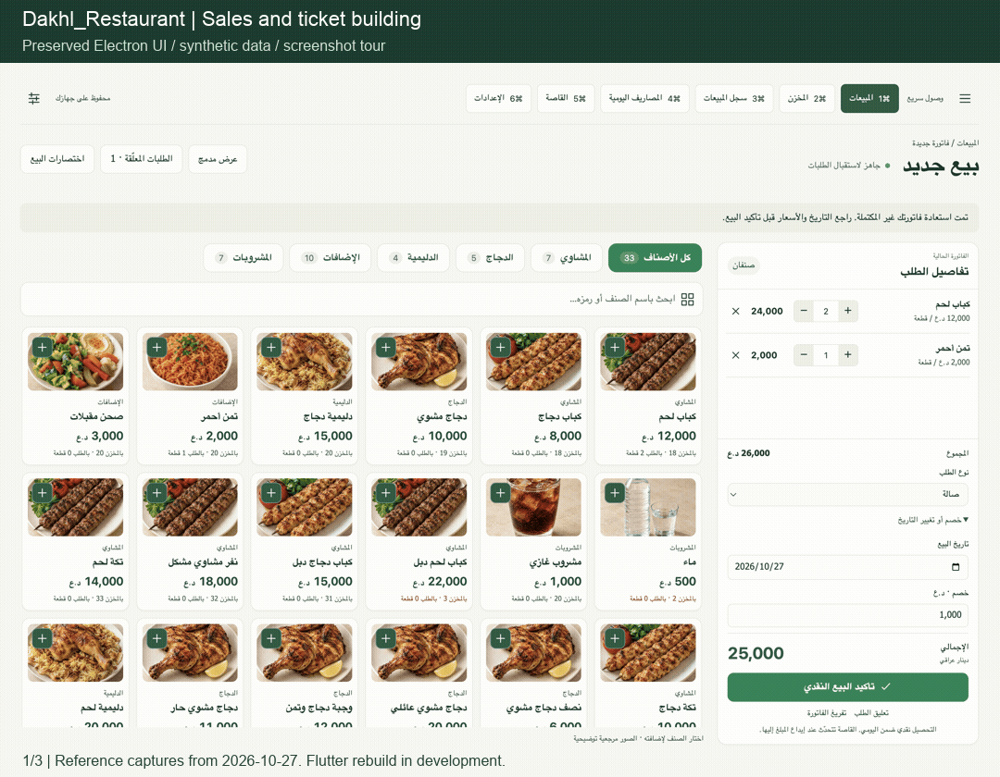

# Dakhl_Restaurant

Offline restaurant sales, inventory and daily accounting with an Arabic RTL interface and Iraqi dinar amounts. It covers day-to-day restaurant operations through local records and explicit backup/import workflows.

The Flutter application shares reusable business capabilities with [Madar_Engine](https://github.com/faroqomar/Madar_Engine). Restaurant screens, workflows and safeguards stay here.

**Status: unreleased development build.** The Flutter work has local implementation and validation evidence on macOS ARM64, Android ARM64 Emulator and iOS ARM64 Simulator. Physical-phone checks, per-form visual acceptance, live financial activation, signing and release remain open. See the [current tracker](PHASES.md) and [local validation record](docs/log/2026-11-08-remaining-completion-closeout.md).

## Preview


**Archived Electron screenshots, synthetic data.** These screenshots show the original application's sales, stock and spending workflows. They are reference captures for the Flutter rebuild.



The GIF cycles through three captured screens; it is a screenshot tour, not an interaction recording. [Full screenshot gallery](docs/planning/flutter-rebuild/gallery.html) · [Media provenance](docs/media/README.md).

## Workflows

- Build cash-sale tickets, hold orders, review saved sales and issue receipts.
- Maintain sellable products and stock movement history.
- Track daily expenses, cashbox movements, suppliers, purchase invoices and payments.
- Export PDF reports and move account data through explicit backup/import workflows.

The retained synthetic screenshots document the original workflow reference. The Flutter app adds reviewed local persistence, history and recovery safeguards, with implementation and test evidence in the [Completion record](docs/log/2026-11-08-remaining-completion-closeout.md). Normal `lib/main.dart` retains the existing account composition; complete-envelope financial workflows require explicit initialization. Local validation does not authorize live-account migration.

## Run the Flutter development app

Requirements: **Flutter 3.47.8 / Dart 3.13.7**, Python 3.10+, and the native toolchain for your target. Use macOS with Xcode for the macOS/iOS targets, or the Android SDK for Android. The SDK constraints live in [.fvmrc](.fvmrc) and [pubspec.yaml](pubspec.yaml).

Clone both repositories as sibling directories. You need repository access to each. Madar is a source dependency; copying its implementation into this app breaks the ownership and verification contract.

```sh
git clone https://github.com/faroqomar/Dakhl_Restaurant.git
git clone https://github.com/faroqomar/Madar_Engine.git
cd Dakhl_Restaurant

# Read this app checkout's required engine revision.
python3 -c 'import json; print(json.load(open("engine-dependency.json"))["git_commit"])'
```

In the new sibling Madar checkout, check out the revision printed above. If that development revision is unavailable remotely, obtain the reviewed source from the maintainer before continuing. Then, from `Dakhl_Restaurant`:

```sh
flutter pub get --enforce-lockfile
python3 scripts/check-engine.py
flutter run -d macos
```

Use `flutter devices` and replace `macos` with your Android emulator or iOS Simulator device ID. Platform setup and native probe limits appear in [integration_test/README.md](integration_test/README.md). The optional collation adapter needs generated native artifacts for full qualification; a fresh clone does not include that evidence. Setup is documented in [Madar's ICU package](https://github.com/faroqomar/Madar_Engine/tree/main/packages/icu_collation).

The development app uses ID `com.eros.dakhlrestaurant.phase00` and a separate data location from the original Electron app. Use disposable synthetic accounts while evaluating it. Back up actual records before any migration or import work.

## Verify

From the Flutter project root after dependency resolution:

```sh
python3 scripts/check-engine.py
flutter analyze --no-pub
flutter test --no-pub --exclude-tags golden
```

The engine checker validates the recorded revision, resolved package sources, versions and pure-core boundary. These commands do not cover native file dialogs, physical printers or production migration. See the [integration-test guide](integration_test/README.md) for those separate checks.

The Electron application and its Node/Electron tooling were retired from this checkout on 2026-11-12. Frozen screenshots and synthetic regression fixtures remain; [the retirement decision](docs/decisions/0022-retire-electron-reference.md) records source recovery and verification limits.

## Architecture and project map

| Location | Responsibility |
| --- | --- |
| `lib/`, `test/`, `integration_test/` | Flutter app, restaurant workflows and app-specific tests |
| [engine-dependency.json](engine-dependency.json) | Reviewed Madar revision and package versions |
| [docs/](docs/README.md) | Contracts, decisions, setup and dated evidence |
| [Screenshot library](docs/planning/flutter-rebuild/gallery.html) | Frozen synthetic UI references |

Madar owns shared contracts, exact-value rules, durable operation coordination and reusable adapters. This app owns Arabic UI, restaurant mappings, document composition and account safeguards. [Ownership contract](docs/decisions/0018-madar-engine-boundary.md).

The app serves one restaurant, works offline and preserves historical records. Manual backup/import does not synchronize devices. Broader cloud services and multi-restaurant operation are outside this app's scope.

Development workflow: [AGENTS](AGENTS.md) · [plans](PLANS.md) · [tracker](PHASES.md) · [prompts](PROMPTS.md). Earlier README delivery snapshots remain in the [historical copy](docs/reference/readme-before-portfolio-2026-11-12.md); current status belongs to the tracker.
