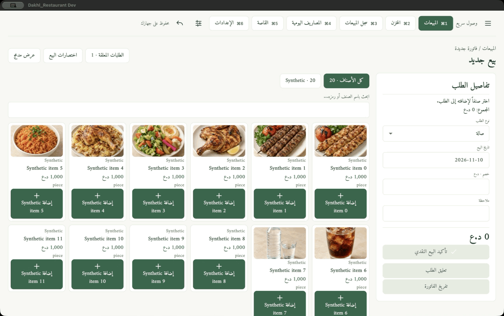
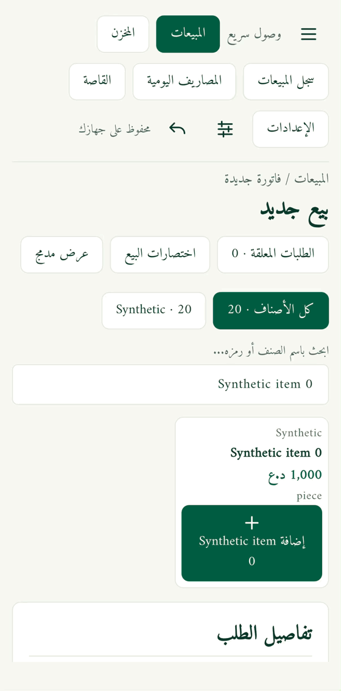
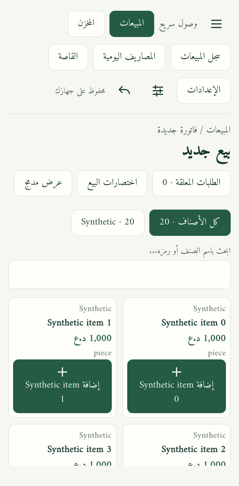

# Dakhl_Restaurant

Dakhl_Restaurant is an offline Flutter app for running sales, stock, and daily accounts at one restaurant. The interface reads right to left in Arabic and records amounts in Iraqi dinars (IQD).

**Development build.** Try the workflows with the included synthetic account. Physical-phone checks, per-form visual acceptance, live financial activation, signing, and release are still open. See the [phase tracker](PHASES.md) and [local validation record](docs/log/2026-11-08-remaining-completion-closeout.md).

## Watch a cash sale

### macOS

Add a product to the ticket beside the catalog and confirm the **1,000 IQD** cash sale. The macOS app saves receipt `S-000005` in a synthetic account.



[Desktop sales catalog](docs/media/desktop-sales-catalog.png) · [Saved desktop receipt](docs/media/desktop-cash-sale-receipt.png)

### iPhone Simulator

Add a product, confirm the cash sale, and open the saved receipt. Receipt `S-000001` shows one synthetic item and a total of **1,000 IQD**.



[View the saved receipt as a still image](docs/media/cash-sale-receipt.png).

## Run the demo

Use Flutter **3.47.8** with Dart **3.13.7**, Python **3.10 or later**, and your target's Flutter toolchain. On a Mac, use Xcode for macOS and iOS Simulator builds. For Android, use the Android SDK and an emulator. You need read access to both repositories. The SDK versions are recorded in [.fvmrc](.fvmrc) and [pubspec.yaml](pubspec.yaml).

Clone the repositories as siblings and select the Madar revision required by this app checkout.

```sh
git clone https://github.com/faroqomar/Dakhl_Restaurant.git
git clone https://github.com/faroqomar/Madar_Engine.git
cd Dakhl_Restaurant
engine_revision="$(python3 -c 'import json; print(json.load(open("engine-dependency.json"))["git_commit"])')"
git -C ../Madar_Engine checkout --detach "$engine_revision"
flutter pub get --enforce-lockfile
python3 scripts/check-engine.py
```

Start a simulator or emulator and find its ID with `flutter devices`. Replace `DEVICE_ID` below with that ID. Use `macos` for the macOS target.

```sh
flutter run --no-pub -d DEVICE_ID \
  -t lib/platform/completion_acceptance_main.dart \
  --dart-define=DAKHL_ACCEPTANCE_ID=readme-demo
```

When the Arabic Sales screen opens with a populated catalog, the demo is ready. The demo starts in its own local account and generates its sample records. Reuse the same demo ID to reopen your sample account, or choose a new ID to start with a fresh fixture.

### Save your first sale

1. On Sales, search for `Synthetic item 0` and add one to the ticket.
2. Scroll to checkout. Check that the total is **1,000 IQD**, then tap **Confirm cash sale**.
3. Open **Receipt details** from the confirmation. The saved receipt shows the item and sale total.



## What you can try

- Build cash-sale tickets, hold orders, and review saved sales and receipts.
- Manage sellable products and review stock movements.
- Record daily expenses, cashbox movements, supplier invoices, and payments in the isolated demo.
- Review PDF reports and try manual account backup and import with disposable demo files.

The app keeps records on the device. Manual backup and import let you move a copy between installations. The normal `lib/main.dart` uses the app's standard account storage. Use the demo entry point above to try financial workflows with sample records.

## Develop and verify

```sh
python3 scripts/check-engine.py
flutter analyze --no-pub
flutter test --no-pub --exclude-tags golden
```

The engine checker verifies the revision and resolved package sources recorded in [engine-dependency.json](engine-dependency.json). [Madar_Engine](https://github.com/faroqomar/Madar_Engine) supplies shared business rules, persistence contracts, and reusable adapters. Dakhl_Restaurant owns the restaurant screens, workflows, document layout, and account safeguards. See the [ownership decision](docs/decisions/0018-madar-engine-boundary.md).

- [Native integration and probe guide](integration_test/README.md)
- [Documentation index](docs/README.md) and [contributor workflow](AGENTS.md)
- [Current capture provenance and archived Electron media](docs/media/README.md)
- [Font source and licenses](assets/fonts/SOURCE.md)

Project-wide licensing is unspecified in this repository.

The [archived Electron screenshots](docs/planning/flutter-rebuild/gallery.html) preserve the reference for the Flutter rebuild. The [retirement decision](docs/decisions/0022-retire-electron-reference.md) records how to recover the old source from Git history.
