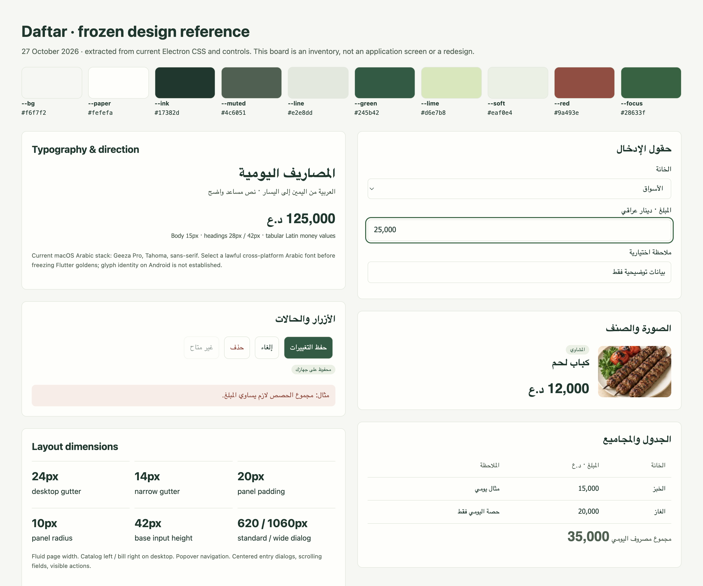
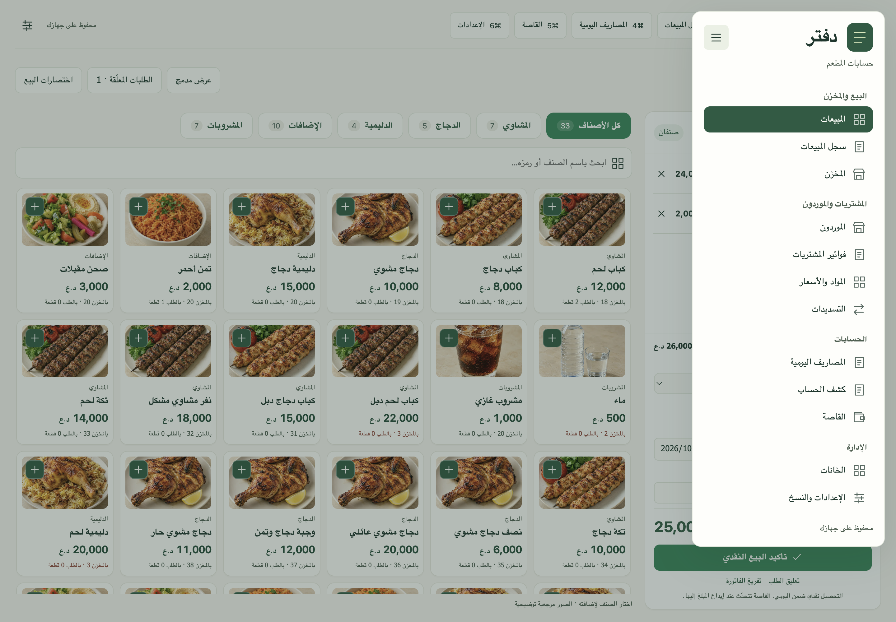

<!-- hindsight:ignore -->

> Historical 19-phase plan, superseded by the [current 12-phase plan](../../../README.md) on 2026-10-27. Do not use these phase numbers for new work.

# Phase 01 — Design system and responsive components

Status: planned, not implemented. Date: 2026-10-27. Depends on: 00.

Outcome: A Flutter component gallery matching the current visual language.

[Master plan](../README.md) · [Screenshot gallery](../gallery.html?phase=01) · [Design contract](../design-system.md) · [Accounting contract](../accounting-parity.md)

## Work to deliver

- [ ] Implement extracted colors, radii, spacing, page gutters, typography roles, Latin tabular financial values, Arabic labels and RTL reading order.
- [ ] Build the actual shared components: toolbar and shortcuts, buttons and icons, inputs, money/quantity/date fields, selects, tables, pagination, filters, badges, empty states, toast/status, standard and wide dialogs.
- [ ] Retain fluid full-width pages, catalog on the left and bill on the right, modest gutters, compact related totals, popover navigation and centered dialogs. Reuse the frozen product thumbnails and icon paths.
- [ ] Reproduce the current narrow reference at 390×844, then verify safe areas, keyboard open, scrollable form content, visible save/cancel, back gesture and large text on Android and iPhone.
- [ ] Choose a licensed Arabic font and establish a golden baseline per platform. Record glyph/rendering differences explicitly; do not claim raw macOS pixels can be identical on every platform.

## Acceptance for this feature

- [ ] Component gallery screenshots cover default, focused, disabled, loading, validation and error states.
- [ ] Side-by-side comparison at the same logical size shows no unexplained layout or copy differences. 320-wide and 200% text tests leave essential actions reachable.

- [ ] Run this phase’s behavior tests with isolated synthetic records; save command/result evidence.
- [ ] Capture the implemented Flutter screen and dialogs on macOS, Android and iPhone; compare the same state and logical size against the references below.
- [ ] Verify empty, populated, invalid, loading, failed-save and retry/cancel states where applicable; test restart persistence for every changed record.
- [ ] Review with the owner at this phase. Preserve the current design unless an explicit change is recorded; an undecided edit does not authorize a redesign.
- [ ] Update feature coverage, decisions and the project log; synchronize project documentation and verify no pending/failed memory work.

## Screenshot references

These are current Electron screenshots with synthetic data, except the explicitly labelled design board and report HTML. They specify composition and current behavior; they do not prove a Flutter implementation. Phone captures are narrow current-UI references, not native Android/iPhone captures. See the capture contract before comparing pixels.

| Reference | Kind |
| --- | --- |
| [design-system](../../../screenshots/design-system.png) | Full viewport |
| [desktop-navigation](../../../screenshots/desktop-navigation.png) | Full viewport |
| [desktop-invoice-new](../../../screenshots/desktop-invoice-new.png) | Full viewport |
| [phone-invoice-new](../../../screenshots/phone-invoice-new.png) | Narrow viewport |

## Handoff for implementation

Read the master plan, this phase, its screenshot set and the linked source evidence. Implement phase 01 only after its dependencies are complete. First report any source/reference mismatch. Use the current design without additional features; ask for the owner’s phase-specific edits when beginning the work. Keep the Electron app and real records safe. End with the working feature, tests, Flutter screenshots, documented differences and updated completion evidence. Do not mark planned work as implemented.
