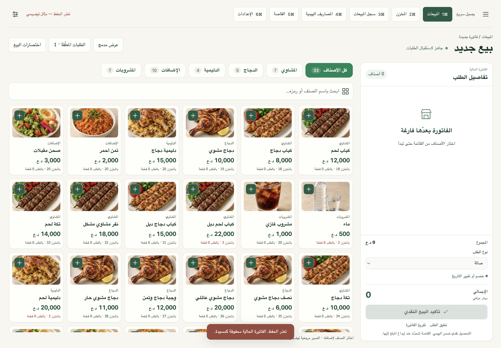
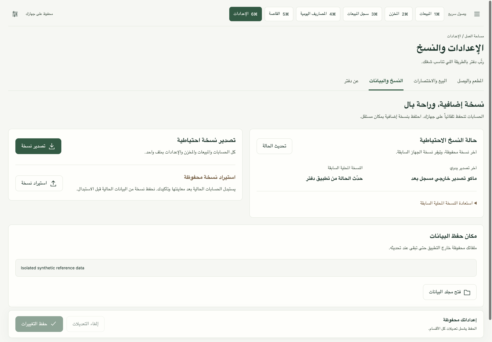

<!-- hindsight:ignore -->

> Historical 19-phase plan, superseded by the [current 12-phase plan](../../../README.md) on 2026-10-27. Do not use these phase numbers for new work.

# Phase 02 — Local accounts, validation and safe persistence

Status: planned, not implemented. Date: 2026-10-27. Depends on: 00, 01.

Outcome: Accounts can be saved, reopened and recovered safely while offline.

[Master plan](../README.md) · [Screenshot gallery](../gallery.html?phase=02) · [Design contract](../design-system.md) · [Accounting contract](../accounting-parity.md)

## Work to deliver

- [ ] Define typed Dart models, codecs, IDs, date-only values, integer IQD money, scaled quantities up to three decimals, exact rounding and shared validation limits. Preserve source semantics and IDs, not just visible totals.
- [ ] Implement repository and local file service boundaries. Proposed first storage is versioned JSON with atomic replacement, validated writes, previous-copy backup and an explicit single-writer policy. Record any alternative in an ADR before changing it.
- [ ] Implement non-destructive legacy migrations for supported Electron schema versions 1–11. Preserve workers/savingsEntries and correction history as compatibility data with no worker UI.
- [ ] Add a separate durable workspace for active/held orders and device-only display preferences. File/account replacement clears old drafts only after a successful replacement.
- [ ] Handle loading, unreadable file, unsupported version, invalid import, full disk/write failure, interrupted write, backup recovery, save retry and app lifecycle interruption. Failed writes never show saved success or clear the user’s form.
- [ ] Create a deterministic parity corpus from synthetic JavaScript inputs/outputs. As each later feature is implemented, run the same cases through Dart; compare records and derived outputs.

## Acceptance for this feature

- [ ] Restart round-trip preserves every supported record and setting. Unknown future schema is rejected without overwriting it.
- [ ] Fault injection at each write boundary recovers either the last valid state or the complete new state. Import size limit and validation match the current 20 MiB boundary unless explicitly changed.
- [ ] All money/date/quantity parsing and migration cases pass in Dart and in the frozen JavaScript reference.

- [ ] Run this phase’s behavior tests with isolated synthetic records; save command/result evidence.
- [ ] Capture the implemented Flutter screen and dialogs on macOS, Android and iPhone; compare the same state and logical size against the references below.
- [ ] Verify empty, populated, invalid, loading, failed-save and retry/cancel states where applicable; test restart persistence for every changed record.
- [ ] Review with the owner at this phase. Preserve the current design unless an explicit change is recorded; an undecided edit does not authorize a redesign.
- [ ] Update feature coverage, decisions and the project log; synchronize project documentation and verify no pending/failed memory work.

## Screenshot references

These are current Electron screenshots with synthetic data, except the explicitly labelled design board and report HTML. They specify composition and current behavior; they do not prove a Flutter implementation. Phone captures are narrow current-UI references, not native Android/iPhone captures. See the capture contract before comparing pixels.

| Reference | Kind |
| --- | --- |
| [desktop-save-error](../../../screenshots/desktop-save-error.png) | Full viewport |
| [desktop-settings-data](../../../screenshots/desktop-settings-data.png) | Full viewport |
| [empty-sales](../../../screenshots/empty-sales.png) | Full viewport |

## Handoff for implementation

Read the master plan, this phase, its screenshot set and the linked source evidence. Implement phase 02 only after its dependencies are complete. First report any source/reference mismatch. Use the current design without additional features; ask for the owner’s phase-specific edits when beginning the work. Keep the Electron app and real records safe. End with the working feature, tests, Flutter screenshots, documented differences and updated completion evidence. Do not mark planned work as implemented.
