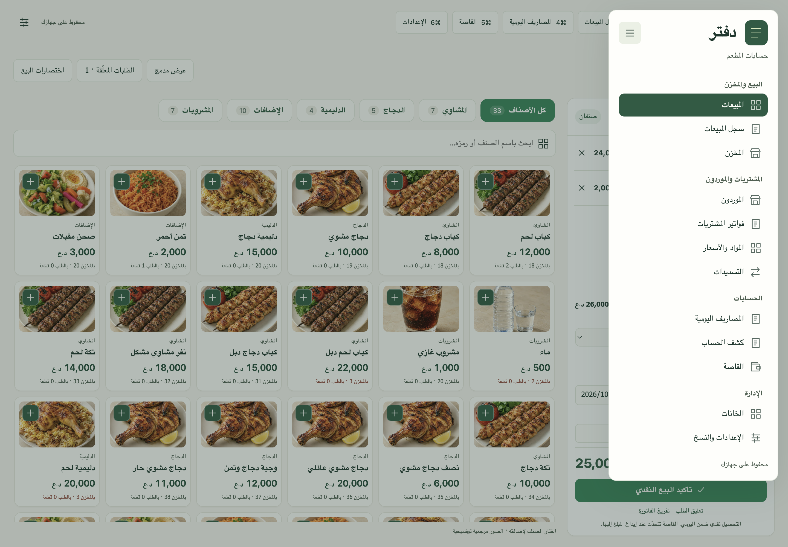

<!-- hindsight:ignore -->

> Historical 19-phase plan, superseded by the [current 12-phase plan](../../../README.md) on 2026-10-27. Do not use these phase numbers for new work.

# Phase 03 — Navigation, shortcuts and interaction shell

Status: planned, not implemented. Date: 2026-10-27. Depends on: 01, 02.

Outcome: All 12 screens are reachable through the same navigation model.

[Master plan](../README.md) · [Screenshot gallery](../gallery.html?phase=03) · [Design contract](../design-system.md) · [Accounting contract](../accounting-parity.md)

## Work to deliver

- [ ] Rebuild the grouped popover menu and dismiss/scrim behavior, six configurable shortcuts, active state and current save/error status.
- [ ] Wire route restoration and unknown destinations back to Sales. Preserve the historic savings shortcut cleanup without exposing a retired screen.
- [ ] Implement keyboard traversal, Escape, focus trapping/restoration, menu shortcuts, session undo dispatch and dirty-form protection. Map mobile back/navigation onto the same rules.
- [ ] Provide compact loading, empty and failure shells without changing domain records. Keep every page aligned to the same gutters.

## Acceptance for this feature

- [ ] Every route opens, closes and restores focus; hidden navigation cannot receive interaction.
- [ ] Unsaved dialogs/settings require a discard decision; canceling it retains content. Navigation does not erase an active ticket.

- [ ] Run this phase’s behavior tests with isolated synthetic records; save command/result evidence.
- [ ] Capture the implemented Flutter screen and dialogs on macOS, Android and iPhone; compare the same state and logical size against the references below.
- [ ] Verify empty, populated, invalid, loading, failed-save and retry/cancel states where applicable; test restart persistence for every changed record.
- [ ] Review with the owner at this phase. Preserve the current design unless an explicit change is recorded; an undecided edit does not authorize a redesign.
- [ ] Update feature coverage, decisions and the project log; synchronize project documentation and verify no pending/failed memory work.

## Screenshot references

These are current Electron screenshots with synthetic data, except the explicitly labelled design board and report HTML. They specify composition and current behavior; they do not prove a Flutter implementation. Phone captures are narrow current-UI references, not native Android/iPhone captures. See the capture contract before comparing pixels.

| Reference | Kind |
| --- | --- |
| [desktop-navigation](../../../screenshots/desktop-navigation.png) | Full viewport |
| [desktop-sales](../../../screenshots/desktop-sales.png) | Full viewport |
| [phone-sales](../../../screenshots/phone-sales.png) | Narrow viewport |

## Handoff for implementation

Read the master plan, this phase, its screenshot set and the linked source evidence. Implement phase 03 only after its dependencies are complete. First report any source/reference mismatch. Use the current design without additional features; ask for the owner’s phase-specific edits when beginning the work. Keep the Electron app and real records safe. End with the working feature, tests, Flutter screenshots, documented differences and updated completion evidence. Do not mark planned work as implemented.
