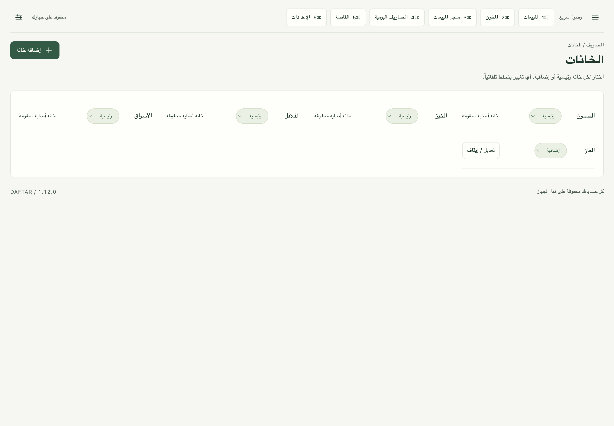
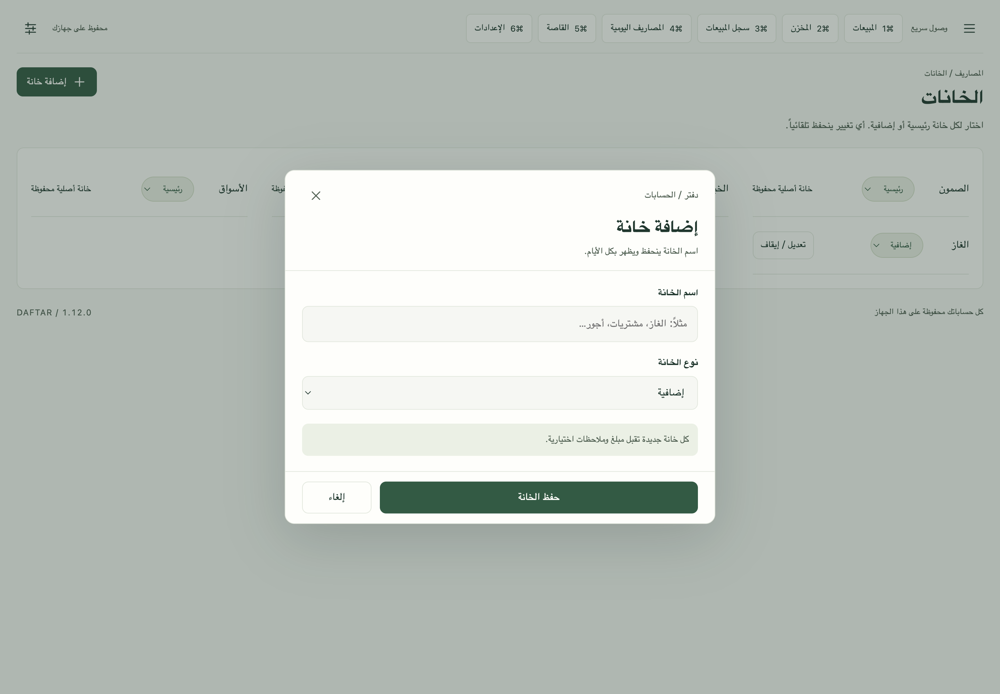

<!-- hindsight:ignore -->

> Historical 19-phase plan, superseded by the [current 12-phase plan](../../../README.md) on 2026-10-27. Do not use these phase numbers for new work.

# Phase 04 — Expense categories

Status: planned, not implemented. Date: 2026-10-27. Depends on: 02, 03.

Outcome: Expense categories can be managed without losing historical references.

[Master plan](../README.md) · [Screenshot gallery](../gallery.html?phase=04) · [Design contract](../design-system.md) · [Accounting contract](../accounting-parity.md)

## Work to deliver

- [ ] Rebuild the category grid, add/edit dialog, primary/additional classification and automatic type save.
- [ ] Preserve built-in category identities and restrictions. Validate names and duplicate handling; allow custom category archive/restore behavior as supported by the source.
- [ ] Expose active categories to new expenses and supplier-payment defaults while historical entries keep their category identity. Support creating a category within the expense form.

## Acceptance for this feature

- [ ] Add/edit/type/archive/reopen work offline and survive restart.
- [ ] Existing expenses and supplier references retain their identity and financial values; invalid names do not save.

- [ ] Run this phase’s behavior tests with isolated synthetic records; save command/result evidence.
- [ ] Capture the implemented Flutter screen and dialogs on macOS, Android and iPhone; compare the same state and logical size against the references below.
- [ ] Verify empty, populated, invalid, loading, failed-save and retry/cancel states where applicable; test restart persistence for every changed record.
- [ ] Review with the owner at this phase. Preserve the current design unless an explicit change is recorded; an undecided edit does not authorize a redesign.
- [ ] Update feature coverage, decisions and the project log; synchronize project documentation and verify no pending/failed memory work.

## Screenshot references

These are current Electron screenshots with synthetic data, except the explicitly labelled design board and report HTML. They specify composition and current behavior; they do not prove a Flutter implementation. Phone captures are narrow current-UI references, not native Android/iPhone captures. See the capture contract before comparing pixels.

| Reference | Kind |
| --- | --- |
| [desktop-categories](../../../screenshots/desktop-categories.png) | Full viewport |
| [desktop-category-new](../../../screenshots/desktop-category-new.png) | Full viewport |
| [desktop-category-edit](../../../screenshots/desktop-category-edit.png) | Full viewport |
| [phone-categories](../../../screenshots/phone-categories.png) | Narrow viewport |
| [empty-categories](../../../screenshots/empty-categories.png) | Full viewport |
| [phone-categories-bottom](../../../screenshots/phone-categories-bottom.png) | Narrow viewport |
| [full-phone-categories](../../../screenshots/full-phone-categories.png) | Full document |
| [full-categories](../../../screenshots/full-categories.png) | Full document |

## Handoff for implementation

Read the master plan, this phase, its screenshot set and the linked source evidence. Implement phase 04 only after its dependencies are complete. First report any source/reference mismatch. Use the current design without additional features; ask for the owner’s phase-specific edits when beginning the work. Keep the Electron app and real records safe. End with the working feature, tests, Flutter screenshots, documented differences and updated completion evidence. Do not mark planned work as implemented.
