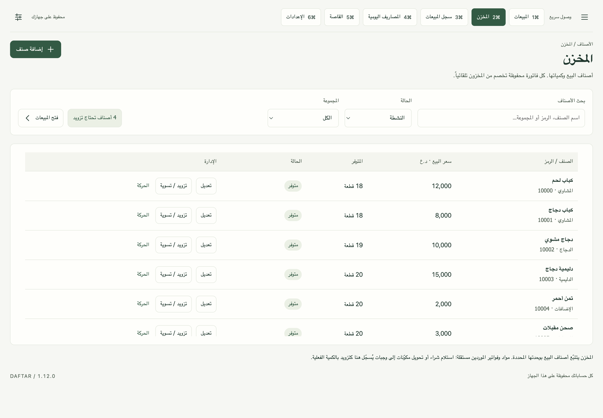
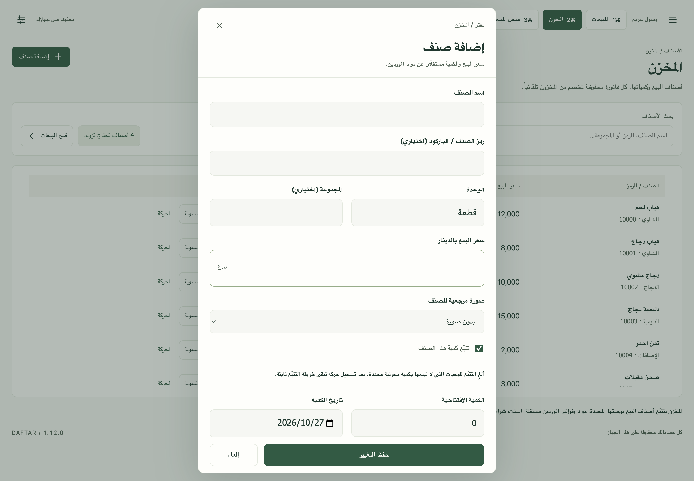

<!-- hindsight:ignore -->

> Historical 19-phase plan, superseded by the [current 12-phase plan](../../../README.md) on 2026-10-27. Do not use these phase numbers for new work.

# Phase 05 — Sellable products and inventory

Status: planned, not implemented. Date: 2026-10-27. Depends on: 02, 03.

Outcome: The sellable catalog and quantity ledger work end to end.

[Master plan](../README.md) · [Screenshot gallery](../gallery.html?phase=05) · [Design contract](../design-system.md) · [Accounting contract](../accounting-parity.md)

## Work to deliver

- [ ] Rebuild catalog table, search, group/status/low-stock filters, pagination, add/edit product, code/barcode text, group, unit, price, reference photo and archive state.
- [ ] Implement tracked/untracked products, opening quantities, restock and signed adjustment/loss, effective dates, low-stock threshold and current-date availability.
- [ ] Rebuild stock history including sale/return links, future movement labels, reversal with reason and trace to the original entry. Corrections preserve history and cannot create negative historical stock.
- [ ] Lock unit/tracking changes once history exists; preserve prices and product details in saved sale lines. Keep supplier ingredients/materials separate: no recipe or automatic purchase-to-product conversion.
- [ ] Barcode is a searchable text/code field here. Camera scanning or new scanner hardware is outside this reproduction unless later requested.

## Acceptance for this feature

- [ ] Opening, sale, return, restock, loss and reversal quantities reconcile for current and historical dates.
- [ ] Archived, unavailable and low-stock states match the reference; filters keep keyboard focus. Changing a current price never rewrites a saved sale.

- [ ] Run this phase’s behavior tests with isolated synthetic records; save command/result evidence.
- [ ] Capture the implemented Flutter screen and dialogs on macOS, Android and iPhone; compare the same state and logical size against the references below.
- [ ] Verify empty, populated, invalid, loading, failed-save and retry/cancel states where applicable; test restart persistence for every changed record.
- [ ] Review with the owner at this phase. Preserve the current design unless an explicit change is recorded; an undecided edit does not authorize a redesign.
- [ ] Update feature coverage, decisions and the project log; synchronize project documentation and verify no pending/failed memory work.

## Screenshot references

These are current Electron screenshots with synthetic data, except the explicitly labelled design board and report HTML. They specify composition and current behavior; they do not prove a Flutter implementation. Phone captures are narrow current-UI references, not native Android/iPhone captures. See the capture contract before comparing pixels.

| Reference | Kind |
| --- | --- |
| [desktop-inventory](../../../screenshots/desktop-inventory.png) | Full viewport |
| [desktop-product-new](../../../screenshots/desktop-product-new.png) | Full viewport |
| [desktop-product-edit](../../../screenshots/desktop-product-edit.png) | Full viewport |
| [desktop-stock](../../../screenshots/desktop-stock.png) | Full viewport |
| [desktop-stock-history](../../../screenshots/desktop-stock-history.png) | Full viewport |
| [desktop-stock-reverse](../../../screenshots/desktop-stock-reverse.png) | Full viewport |
| [phone-inventory](../../../screenshots/phone-inventory.png) | Narrow viewport |
| [desktop-product-new-bottom](../../../screenshots/desktop-product-new-bottom.png) | Full viewport |
| [desktop-product-edit-bottom](../../../screenshots/desktop-product-edit-bottom.png) | Full viewport |
| [empty-inventory](../../../screenshots/empty-inventory.png) | Full viewport |
| [phone-inventory-bottom](../../../screenshots/phone-inventory-bottom.png) | Narrow viewport |
| [phone-product-new](../../../screenshots/phone-product-new.png) | Narrow viewport |
| [phone-product-new-bottom](../../../screenshots/phone-product-new-bottom.png) | Narrow viewport |
| [full-phone-inventory](../../../screenshots/full-phone-inventory.png) | Full document |
| [full-inventory](../../../screenshots/full-inventory.png) | Full document |

## Handoff for implementation

Read the master plan, this phase, its screenshot set and the linked source evidence. Implement phase 05 only after its dependencies are complete. First report any source/reference mismatch. Use the current design without additional features; ask for the owner’s phase-specific edits when beginning the work. Keep the Electron app and real records safe. End with the working feature, tests, Flutter screenshots, documented differences and updated completion evidence. Do not mark planned work as implemented.
