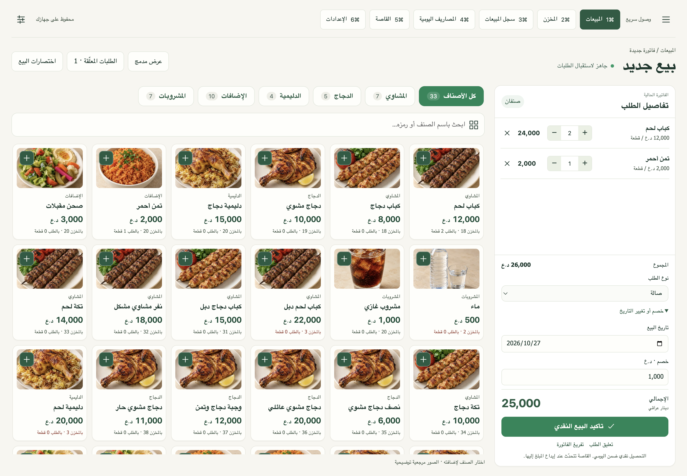

<!-- hindsight:ignore -->

> Historical 19-phase plan, superseded by the [current 12-phase plan](../../../README.md) on 2026-10-27. Do not use these phase numbers for new work.

# Phase 06 — Cash sale and saved receipt

Status: planned, not implemented. Date: 2026-10-27. Depends on: 02, 03, 05.

Outcome: A sale can be completed once and safely, with stock and daily proceeds updated.

[Master plan](../README.md) · [Screenshot gallery](../gallery.html?phase=06) · [Design contract](../design-system.md) · [Accounting contract](../accounting-parity.md)

## Work to deliver

- [ ] Reproduce photo cards, corner plus/count, group tabs/counts, search, compact display toggle and catalog pagination/scrolling.
- [ ] Build the right-hand ticket with quantity increment/decrement/direct entry, remove line, fixed discount, note, date, order type, subtotal and total; retain the price captured when adding an item.
- [ ] Exact-value checkout means confirming receipt of the net total. Do not add a tendered-cash input, taxes, fees, credit customers or automatic delivery charges.
- [ ] Persist before presenting the paid receipt. Protect duplicate taps, retries and stale workspace writes using durable operation/sale identity. Keep the ticket on any failed validation or save.
- [ ] After a successful save open the paid receipt with close/new-order, details, PDF and system-print actions. Connect file/print services incrementally; their final cross-platform completion is phase 17.

## Acceptance for this feature

- [ ] Subtotal minus discount equals stored net; stock and daily sales change once. Retrying after restart cannot duplicate a saved sale or reuse a sale number.
- [ ] Empty ticket, insufficient stock, archived product, invalid discount and changed date have explicit states. Failed saves retain the ticket.

- [ ] Run this phase’s behavior tests with isolated synthetic records; save command/result evidence.
- [ ] Capture the implemented Flutter screen and dialogs on macOS, Android and iPhone; compare the same state and logical size against the references below.
- [ ] Verify empty, populated, invalid, loading, failed-save and retry/cancel states where applicable; test restart persistence for every changed record.
- [ ] Review with the owner at this phase. Preserve the current design unless an explicit change is recorded; an undecided edit does not authorize a redesign.
- [ ] Update feature coverage, decisions and the project log; synchronize project documentation and verify no pending/failed memory work.

## Screenshot references

These are current Electron screenshots with synthetic data, except the explicitly labelled design board and report HTML. They specify composition and current behavior; they do not prove a Flutter implementation. Phone captures are narrow current-UI references, not native Android/iPhone captures. See the capture contract before comparing pixels.

| Reference | Kind |
| --- | --- |
| [desktop-sales](../../../screenshots/desktop-sales.png) | Full viewport |
| [desktop-sales-cart](../../../screenshots/desktop-sales-cart.png) | Full viewport |
| [desktop-sales-compact](../../../screenshots/desktop-sales-compact.png) | Full viewport |
| [desktop-sales-catalog-bottom](../../../screenshots/desktop-sales-catalog-bottom.png) | Full viewport |
| [desktop-sales-no-results](../../../screenshots/desktop-sales-no-results.png) | Full viewport |
| [desktop-sale-paid](../../../screenshots/desktop-sale-paid.png) | Full viewport |
| [phone-sales](../../../screenshots/phone-sales.png) | Narrow viewport |
| [empty-sales](../../../screenshots/empty-sales.png) | Full viewport |
| [phone-sales-bottom](../../../screenshots/phone-sales-bottom.png) | Narrow viewport |
| [phone-sales-cart](../../../screenshots/phone-sales-cart.png) | Narrow viewport |
| [phone-sales-cart-bottom](../../../screenshots/phone-sales-cart-bottom.png) | Narrow viewport |
| [full-phone-sales](../../../screenshots/full-phone-sales.png) | Full document |
| [full-sales](../../../screenshots/full-sales.png) | Full document |

## Handoff for implementation

Read the master plan, this phase, its screenshot set and the linked source evidence. Implement phase 06 only after its dependencies are complete. First report any source/reference mismatch. Use the current design without additional features; ask for the owner’s phase-specific edits when beginning the work. Keep the Electron app and real records safe. End with the working feature, tests, Flutter screenshots, documented differences and updated completion evidence. Do not mark planned work as implemented.
