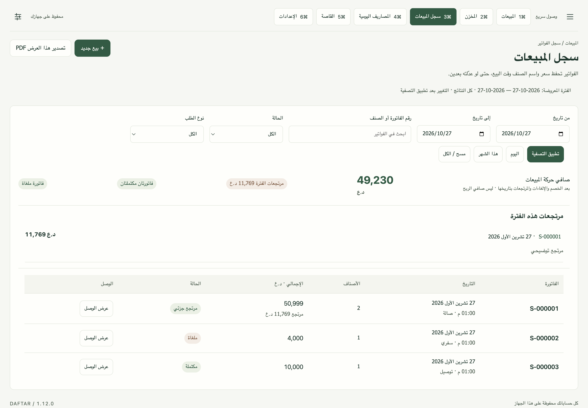
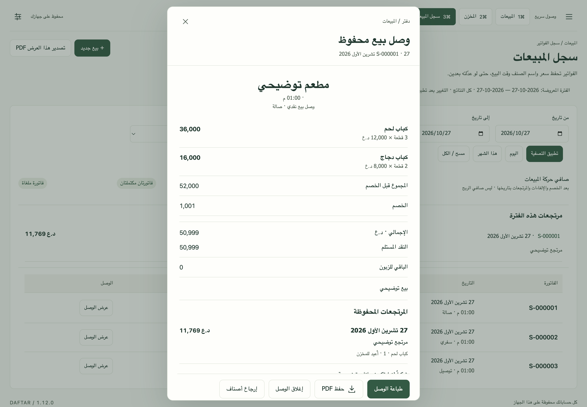

<!-- hindsight:ignore -->

> Historical 19-phase plan, superseded by the [current 12-phase plan](../../../README.md) on 2026-10-27. Do not use these phase numbers for new work.

# Phase 08 — Sales history, returns and voids

Status: planned, not implemented. Date: 2026-10-27. Depends on: 02, 05, 06.

Outcome: Saved sales can be found, inspected, refunded or corrected with faithful accounting.

[Master plan](../README.md) · [Screenshot gallery](../gallery.html?phase=08) · [Design contract](../design-system.md) · [Accounting contract](../accounting-parity.md)

## Work to deliver

- [ ] Rebuild date/query/status/order-type filters, presets, pagination, totals, saved/void receipts and refund history.
- [ ] Implement partial and full returns with quantity, date, reason, explicit cash-refund confirmation and per-line optional restock. Display the calculated refund before saving.
- [ ] Use original price snapshots and cumulative discount allocation/rounding. Full successive refunds must equal the original net exactly, including fractional quantities.
- [ ] Refund affects daily net proceeds on its return date, never an expense or automatic cashbox withdrawal. Restock affects only the return date when selected.
- [ ] Void a sale without returns only, with reason and original-date reversal. Preserve its number and original record. A sale with returns uses further returns rather than void.

## Acceptance for this feature

- [ ] Over-return, duplicate return and invalid dates are rejected. Full returns reconcile exactly and cannot double-deduct a fresh remaining snapshot.
- [ ] History totals use sale dates and refund dates correctly, including a negative net return-only period. Saved receipt details persist after price changes.

- [ ] Run this phase’s behavior tests with isolated synthetic records; save command/result evidence.
- [ ] Capture the implemented Flutter screen and dialogs on macOS, Android and iPhone; compare the same state and logical size against the references below.
- [ ] Verify empty, populated, invalid, loading, failed-save and retry/cancel states where applicable; test restart persistence for every changed record.
- [ ] Review with the owner at this phase. Preserve the current design unless an explicit change is recorded; an undecided edit does not authorize a redesign.
- [ ] Update feature coverage, decisions and the project log; synchronize project documentation and verify no pending/failed memory work.

## Screenshot references

These are current Electron screenshots with synthetic data, except the explicitly labelled design board and report HTML. They specify composition and current behavior; they do not prove a Flutter implementation. Phone captures are narrow current-UI references, not native Android/iPhone captures. See the capture contract before comparing pixels.

| Reference | Kind |
| --- | --- |
| [desktop-sale-history](../../../screenshots/desktop-sale-history.png) | Full viewport |
| [desktop-receipt](../../../screenshots/desktop-receipt.png) | Full viewport |
| [desktop-sale-return](../../../screenshots/desktop-sale-return.png) | Full viewport |
| [desktop-sale-void](../../../screenshots/desktop-sale-void.png) | Full viewport |
| [desktop-void-receipt](../../../screenshots/desktop-void-receipt.png) | Full viewport |
| [phone-sale-return](../../../screenshots/phone-sale-return.png) | Narrow viewport |
| [desktop-sale-history-bottom](../../../screenshots/desktop-sale-history-bottom.png) | Full viewport |
| [desktop-receipt-bottom](../../../screenshots/desktop-receipt-bottom.png) | Full viewport |
| [empty-sale-history](../../../screenshots/empty-sale-history.png) | Full viewport |
| [phone-sale-history](../../../screenshots/phone-sale-history.png) | Narrow viewport |
| [phone-sale-history-bottom](../../../screenshots/phone-sale-history-bottom.png) | Narrow viewport |
| [phone-receipt](../../../screenshots/phone-receipt.png) | Narrow viewport |
| [phone-receipt-bottom](../../../screenshots/phone-receipt-bottom.png) | Narrow viewport |
| [phone-sale-return-bottom](../../../screenshots/phone-sale-return-bottom.png) | Narrow viewport |
| [full-phone-sale-history](../../../screenshots/full-phone-sale-history.png) | Full document |
| [full-sale-history](../../../screenshots/full-sale-history.png) | Full document |

## Handoff for implementation

Read the master plan, this phase, its screenshot set and the linked source evidence. Implement phase 08 only after its dependencies are complete. First report any source/reference mismatch. Use the current design without additional features; ask for the owner’s phase-specific edits when beginning the work. Keep the Electron app and real records safe. End with the working feature, tests, Flutter screenshots, documented differences and updated completion evidence. Do not mark planned work as implemented.
