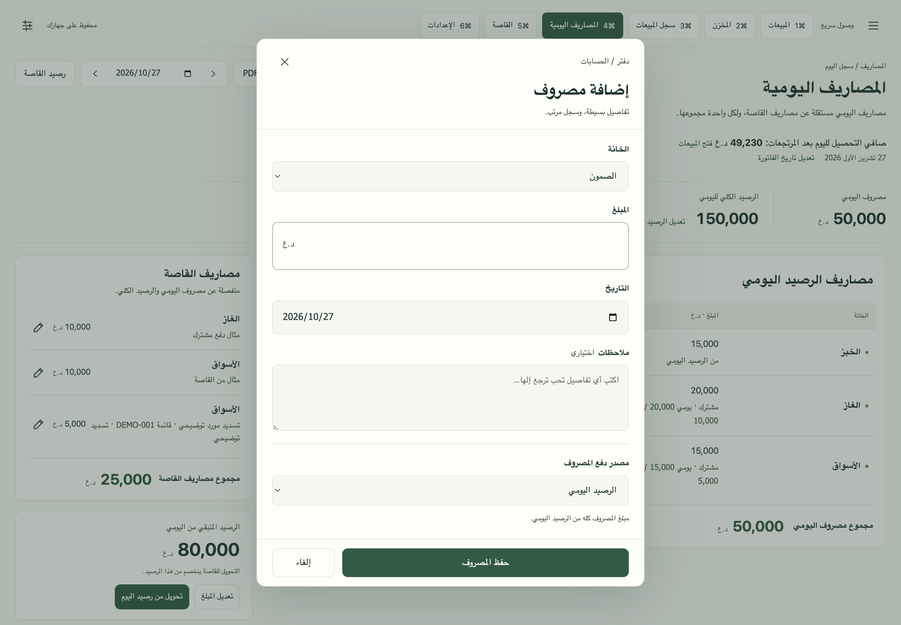

<!-- hindsight:ignore -->

> Historical 19-phase plan, superseded by the [current 12-phase plan](../../../README.md) on 2026-10-27. Do not use these phase numbers for new work.

# Phase 09 — Daily expenses, remaining cash and chicken counts

Status: planned, not implemented. Date: 2026-10-27. Depends on: 02, 04, 08.

Outcome: The daily ledger and its balances match the existing accounting rules.

[Master plan](../README.md) · [Screenshot gallery](https://github.com/faroqomar/Dakhl_Restaurant/blob/433ee33f1b2811687cc8b23af2c5c9014786de5d/docs/planning/flutter-rebuild/archive/v1-19-phases/gallery.html) · [Design contract](../design-system.md) · [Accounting contract](../accounting-parity.md)

## Work to deliver

- [ ] Reproduce the daily table plus compact secondary cash-expense/remaining/chicken column; date selection, previous/next/today, expense add/edit/delete and notes.
- [ ] Implement daily/cash/shared funding with both shares validated. A shared expense appears in both source views, with no duplication in daily totals.
- [ ] Port remaining-cash snapshots and total-balance recording, automatic/manual expense totals, correction reasons/history, clear balance and session undo preserving inverse correction records.
- [ ] Port daily date correction and optional shift of following recorded days with preview/collision protection. Respect the independent dates of supplier invoices/debts, sales and inventory.
- [ ] Chicken used/left are counts only. Keep daily sales/refunds integrated with remaining snapshots without treating balances as profit.

## Acceptance for this feature

- [ ] The numerical examples in accounting-parity.md pass for edits/deletes, shared funding, snapshots, later sales/refunds and transfers.
- [ ] Correction/undo/date-shift tests preserve linked records and reject overlaps; chicken changes affect no monetary result.

- [ ] Run this phase’s behavior tests with isolated synthetic records; save command/result evidence.
- [ ] Capture the implemented Flutter screen and dialogs on macOS, Android and iPhone; compare the same state and logical size against the references below.
- [ ] Verify empty, populated, invalid, loading, failed-save and retry/cancel states where applicable; test restart persistence for every changed record.
- [ ] Review with the owner at this phase. Preserve the current design unless an explicit change is recorded; an undecided edit does not authorize a redesign.
- [ ] Update feature coverage, decisions and the project log; synchronize project documentation and verify no pending/failed memory work.

## Screenshot references

These are current Electron screenshots with synthetic data, except the explicitly labelled design board and report HTML. They specify composition and current behavior; they do not prove a Flutter implementation. Phone captures are narrow current-UI references, not native Android/iPhone captures. See the capture contract before comparing pixels.

| Reference | Kind |
| --- | --- |
| [desktop-expenses](../../../screenshots/desktop-expenses.png) | Full viewport |
| [desktop-expense-new](../../../screenshots/desktop-expense-new.png) | Full viewport |
| [desktop-expense-edit](../../../screenshots/desktop-expense-edit.png) | Full viewport |
| [desktop-validation](../../../screenshots/desktop-validation.png) | Full viewport |
| [desktop-remaining](../../../screenshots/desktop-remaining.png) | Full viewport |
| [desktop-total](../../../screenshots/desktop-total.png) | Full viewport |
| [desktop-balance](../../../screenshots/desktop-balance.png) | Full viewport |
| [desktop-day-date](../../../screenshots/desktop-day-date.png) | Full viewport |
| [desktop-chicken](../../../screenshots/desktop-chicken.png) | Full viewport |
| [phone-expenses](../../../screenshots/phone-expenses.png) | Narrow viewport |
| [desktop-expenses-bottom](../../../screenshots/desktop-expenses-bottom.png) | Full viewport |
| [desktop-expense-edit-bottom](../../../screenshots/desktop-expense-edit-bottom.png) | Full viewport |
| [empty-expenses](../../../screenshots/empty-expenses.png) | Full viewport |
| [phone-expenses-bottom](../../../screenshots/phone-expenses-bottom.png) | Narrow viewport |
| [phone-expense-new](../../../screenshots/phone-expense-new.png) | Narrow viewport |
| [phone-expense-new-bottom](../../../screenshots/phone-expense-new-bottom.png) | Narrow viewport |
| [full-phone-expenses](../../../screenshots/full-phone-expenses.png) | Full document |
| [full-expenses](../../../screenshots/full-expenses.png) | Full document |

## Handoff for implementation

Read the master plan, this phase, its screenshot set and the linked source evidence. Implement phase 09 only after its dependencies are complete. First report any source/reference mismatch. Use the current design without additional features; ask for the owner’s phase-specific edits when beginning the work. Keep the Electron app and real records safe. End with the working feature, tests, Flutter screenshots, documented differences and updated completion evidence. Do not mark planned work as implemented.
