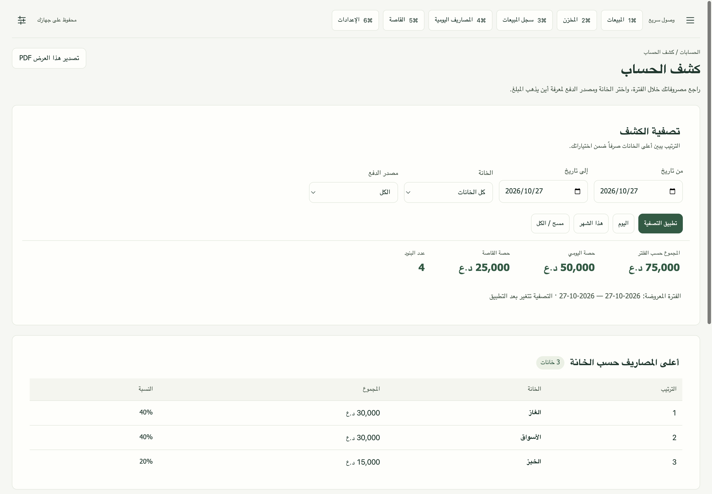
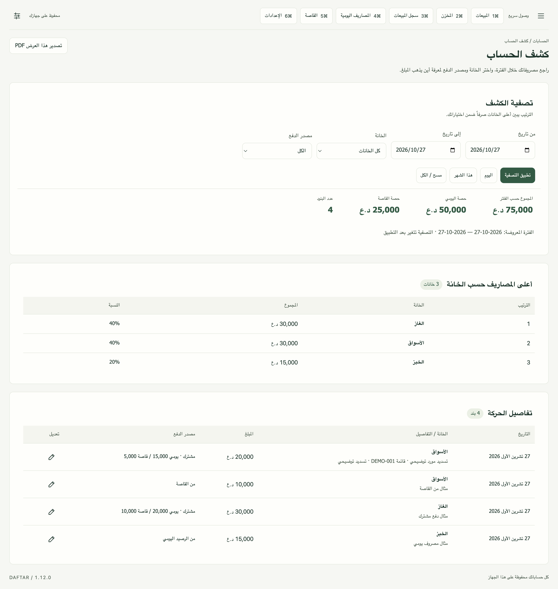

<!-- hindsight:ignore -->

> Historical 19-phase plan, superseded by the [current 12-phase plan](../../../README.md) on 2026-10-27. Do not use these phase numbers for new work.

# Phase 10 — Account statement and day review

Status: planned, not implemented. Date: 2026-10-27. Depends on: 03, 09.

Outcome: Paid spending can be reviewed for a period and a day can be checked without closing it.

[Master plan](../README.md) · [Screenshot gallery](https://github.com/faroqomar/Dakhl_Restaurant/blob/433ee33f1b2811687cc8b23af2c5c9014786de5d/docs/planning/flutter-rebuild/archive/v1-19-phases/gallery.html) · [Design contract](../design-system.md) · [Accounting contract](../accounting-parity.md)

## Work to deliver

- [ ] Reproduce from/to, category and source filters, date presets, summary amounts, descending category ranking, transaction detail and pagination.
- [ ] Use paid expenses and supplier payments, not unpaid invoice totals. Source-filtered shares remain correctly classified.
- [ ] Rebuild the short day-review dialog, temporary checkboxes, sales/refund/spending facts, record-remaining link, optional transfer and daily PDF link.
- [ ] Keep day review informational. It does not create an immutable closing record, lock a date or calculate profit.

## Acceptance for this feature

- [ ] Cash-source filtering shows zero daily share, matching the reference. Ranked totals reconcile to visible rows.
- [ ] Review checkboxes change no account data and no financial amount; links return to the correct daily context.

- [ ] Run this phase’s behavior tests with isolated synthetic records; save command/result evidence.
- [ ] Capture the implemented Flutter screen and dialogs on macOS, Android and iPhone; compare the same state and logical size against the references below.
- [ ] Verify empty, populated, invalid, loading, failed-save and retry/cancel states where applicable; test restart persistence for every changed record.
- [ ] Review with the owner at this phase. Preserve the current design unless an explicit change is recorded; an undecided edit does not authorize a redesign.
- [ ] Update feature coverage, decisions and the project log; synchronize project documentation and verify no pending/failed memory work.

## Screenshot references

These are current Electron screenshots with synthetic data, except the explicitly labelled design board and report HTML. They specify composition and current behavior; they do not prove a Flutter implementation. Phone captures are narrow current-UI references, not native Android/iPhone captures. See the capture contract before comparing pixels.

| Reference | Kind |
| --- | --- |
| [desktop-statement](../../../screenshots/desktop-statement.png) | Full viewport |
| [full-statement](../../../screenshots/full-statement.png) | Full document |
| [desktop-day-review](../../../screenshots/desktop-day-review.png) | Full viewport |
| [phone-statement](../../../screenshots/phone-statement.png) | Narrow viewport |
| [desktop-statement-bottom](../../../screenshots/desktop-statement-bottom.png) | Full viewport |
| [empty-statement](../../../screenshots/empty-statement.png) | Full viewport |
| [phone-statement-bottom](../../../screenshots/phone-statement-bottom.png) | Narrow viewport |
| [full-phone-statement](../../../screenshots/full-phone-statement.png) | Full document |

## Handoff for implementation

Read the master plan, this phase, its screenshot set and the linked source evidence. Implement phase 10 only after its dependencies are complete. First report any source/reference mismatch. Use the current design without additional features; ask for the owner’s phase-specific edits when beginning the work. Keep the Electron app and real records safe. End with the working feature, tests, Flutter screenshots, documented differences and updated completion evidence. Do not mark planned work as implemented.
