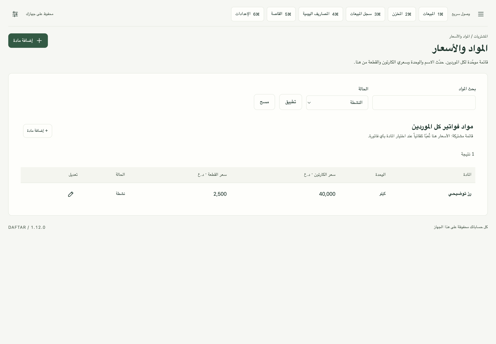
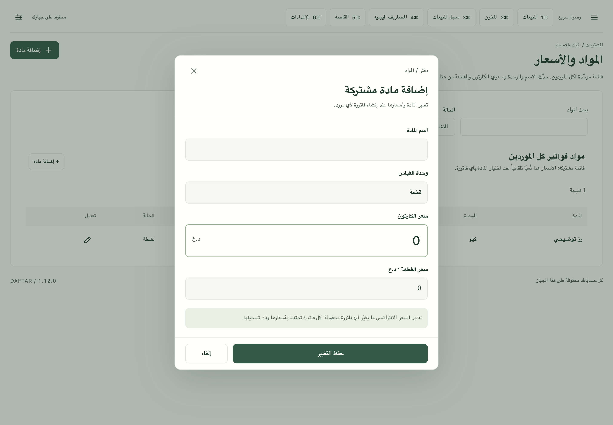

<!-- hindsight:ignore -->

> Historical 19-phase plan, superseded by the [current 12-phase plan](../../../README.md) on 2026-10-27. Do not use these phase numbers for new work.

# Phase 12 — Shared supplier materials and default prices

Status: planned, not implemented. Date: 2026-10-27. Depends on: 02, 03, 11.

Outcome: One materials catalog provides reusable invoice defaults.

[Master plan](../README.md) · [Screenshot gallery](../gallery.html?phase=12) · [Design contract](../design-system.md) · [Accounting contract](../accounting-parity.md)

## Work to deliver

- [ ] Reproduce material search/status filters, add/edit/archive, name, unit and independent carton/piece defaults.
- [ ] Keep one shared catalog across suppliers. Selecting a material fills defaults in a new invoice but saves a snapshot on that invoice.
- [ ] Preserve legacy material identity/migration and duplicate-name handling. Do not infer a carton-to-piece conversion.

## Acceptance for this feature

- [ ] Editing or archiving a material never rewrites an earlier invoice or debt total.
- [ ] New invoice selection uses current defaults, while legacy single-unit lines remain readable and retain totals.

- [ ] Run this phase’s behavior tests with isolated synthetic records; save command/result evidence.
- [ ] Capture the implemented Flutter screen and dialogs on macOS, Android and iPhone; compare the same state and logical size against the references below.
- [ ] Verify empty, populated, invalid, loading, failed-save and retry/cancel states where applicable; test restart persistence for every changed record.
- [ ] Review with the owner at this phase. Preserve the current design unless an explicit change is recorded; an undecided edit does not authorize a redesign.
- [ ] Update feature coverage, decisions and the project log; synchronize project documentation and verify no pending/failed memory work.

## Screenshot references

These are current Electron screenshots with synthetic data, except the explicitly labelled design board and report HTML. They specify composition and current behavior; they do not prove a Flutter implementation. Phone captures are narrow current-UI references, not native Android/iPhone captures. See the capture contract before comparing pixels.

| Reference | Kind |
| --- | --- |
| [desktop-materials](../../../screenshots/desktop-materials.png) | Full viewport |
| [desktop-material-new](../../../screenshots/desktop-material-new.png) | Full viewport |
| [desktop-material-edit](../../../screenshots/desktop-material-edit.png) | Full viewport |
| [phone-materials](../../../screenshots/phone-materials.png) | Narrow viewport |
| [empty-materials](../../../screenshots/empty-materials.png) | Full viewport |
| [phone-materials-bottom](../../../screenshots/phone-materials-bottom.png) | Narrow viewport |
| [full-phone-materials](../../../screenshots/full-phone-materials.png) | Full document |
| [full-materials](../../../screenshots/full-materials.png) | Full document |

## Handoff for implementation

Read the master plan, this phase, its screenshot set and the linked source evidence. Implement phase 12 only after its dependencies are complete. First report any source/reference mismatch. Use the current design without additional features; ask for the owner’s phase-specific edits when beginning the work. Keep the Electron app and real records safe. End with the working feature, tests, Flutter screenshots, documented differences and updated completion evidence. Do not mark planned work as implemented.
