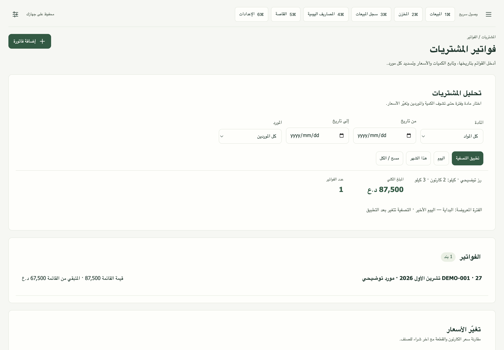
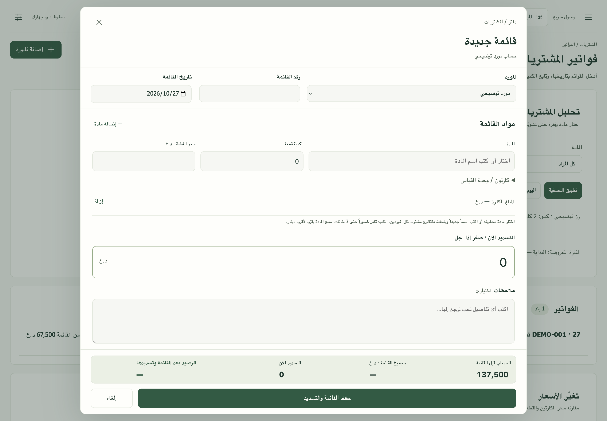

<!-- hindsight:ignore -->

> Historical 19-phase plan, superseded by the [current 12-phase plan](../../../README.md) on 2026-10-27. Do not use these phase numbers for new work.

# Phase 13 — Purchase invoices and purchase analysis

Status: planned, not implemented. Date: 2026-10-27. Depends on: 02, 11, 12.

Outcome: Dated supplier invoices and their quantity/price analysis work offline.

[Master plan](../README.md) · [Screenshot gallery](https://github.com/faroqomar/Dakhl_Restaurant/blob/433ee33f1b2811687cc8b23af2c5c9014786de5d/docs/planning/flutter-rebuild/archive/v1-19-phases/gallery.html) · [Design contract](../design-system.md) · [Accounting contract](../accounting-parity.md)

## Work to deliver

- [ ] Rebuild separate purchase-invoice page, supplier/material/date filters, purchase groups/details and quantity/price history comparisons.
- [ ] Reproduce the wide invoice dialog with visible supplier/date/number context, scrollable lines and total/save actions. Support adding/selecting materials inline.
- [ ] Enter carton and piece quantities/prices independently; save snapshots and notes. Permit historical invoices with unique invoice number per supplier.
- [ ] Create liability only for an unpaid invoice. Invoice-with-payment must commit the invoice and payment together, following phase 14 allocation/funding rules; that path cannot be called finished before phase 14.
- [ ] Restrict edit/delete when payments exist. Preserve legacy quantity × unit-price lines and unit-aware analysis.

## Acceptance for this feature

- [ ] Carton/piece calculations match rounding and range limits; quantities aggregate by unit without fabricated conversion.
- [ ] Paid invoices cannot be deleted or reduced below their allocation. Inline material creation plus invoice save is atomic.

- [ ] Run this phase’s behavior tests with isolated synthetic records; save command/result evidence.
- [ ] Capture the implemented Flutter screen and dialogs on macOS, Android and iPhone; compare the same state and logical size against the references below.
- [ ] Verify empty, populated, invalid, loading, failed-save and retry/cancel states where applicable; test restart persistence for every changed record.
- [ ] Review with the owner at this phase. Preserve the current design unless an explicit change is recorded; an undecided edit does not authorize a redesign.
- [ ] Update feature coverage, decisions and the project log; synchronize project documentation and verify no pending/failed memory work.

## Screenshot references

These are current Electron screenshots with synthetic data, except the explicitly labelled design board and report HTML. They specify composition and current behavior; they do not prove a Flutter implementation. Phone captures are narrow current-UI references, not native Android/iPhone captures. See the capture contract before comparing pixels.

| Reference | Kind |
| --- | --- |
| [desktop-invoices](../../../screenshots/desktop-invoices.png) | Full viewport |
| [desktop-invoice-new](../../../screenshots/desktop-invoice-new.png) | Full viewport |
| [desktop-invoice-new-bottom](../../../screenshots/desktop-invoice-new-bottom.png) | Full viewport |
| [desktop-invoice-edit](../../../screenshots/desktop-invoice-edit.png) | Full viewport |
| [phone-invoice-new](../../../screenshots/phone-invoice-new.png) | Narrow viewport |
| [desktop-invoices-bottom](../../../screenshots/desktop-invoices-bottom.png) | Full viewport |
| [desktop-invoice-edit-bottom](../../../screenshots/desktop-invoice-edit-bottom.png) | Full viewport |
| [desktop-invoice-cartons](../../../screenshots/desktop-invoice-cartons.png) | Full viewport |
| [empty-invoices](../../../screenshots/empty-invoices.png) | Full viewport |
| [phone-invoices](../../../screenshots/phone-invoices.png) | Narrow viewport |
| [phone-invoices-bottom](../../../screenshots/phone-invoices-bottom.png) | Narrow viewport |
| [phone-invoice-new-bottom](../../../screenshots/phone-invoice-new-bottom.png) | Narrow viewport |
| [full-phone-invoices](../../../screenshots/full-phone-invoices.png) | Full document |
| [full-invoices](../../../screenshots/full-invoices.png) | Full document |

## Handoff for implementation

Read the master plan, this phase, its screenshot set and the linked source evidence. Implement phase 13 only after its dependencies are complete. First report any source/reference mismatch. Use the current design without additional features; ask for the owner’s phase-specific edits when beginning the work. Keep the Electron app and real records safe. End with the working feature, tests, Flutter screenshots, documented differences and updated completion evidence. Do not mark planned work as implemented.
