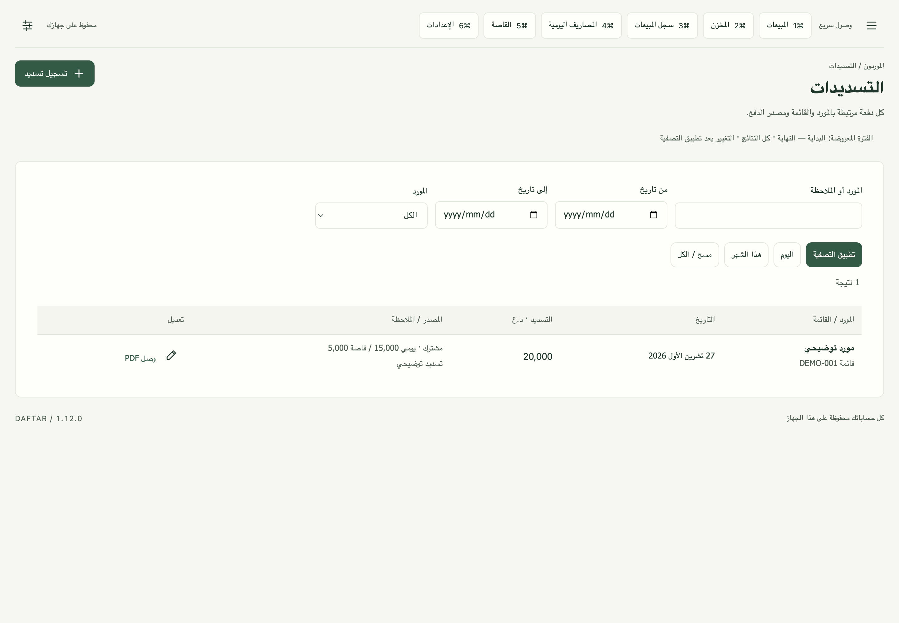
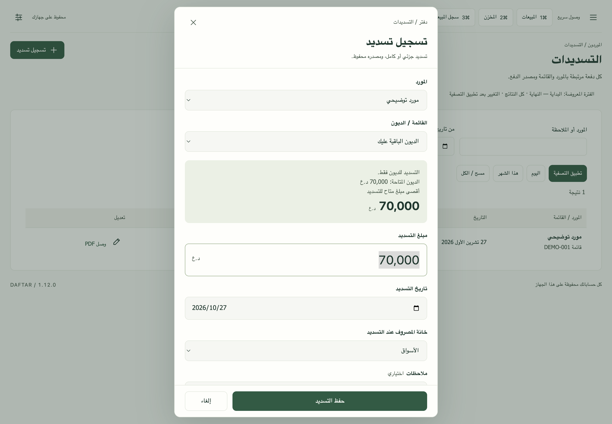

<!-- hindsight:ignore -->

> Historical 19-phase plan, superseded by the [current 12-phase plan](../../../README.md) on 2026-10-27. Do not use these phase numbers for new work.

# Phase 14 — Supplier payments and allocation

Status: planned, not implemented. Date: 2026-10-27. Depends on: 02, 09, 11, 13.

Outcome: Partial/full supplier settlement affects expenses and its funding source exactly once.

[Master plan](../README.md) · [Screenshot gallery](../gallery.html?phase=14) · [Design contract](../design-system.md) · [Accounting contract](../accounting-parity.md)

## Work to deliver

- [ ] Rebuild payments list/filter/pagination and new/edit/delete payment dialog, supplier/invoice/debt choice, amount/date/category/note and funding split.
- [ ] Implement available amount and preview: pay the selected invoice first, then eligible supplier debt; store invoiceAmount and debtAmount.
- [ ] Never spill excess into another invoice or future debt. Prevent orphan references, wrong supplier, invalid payment date and overpayment.
- [ ] Connect purchase-with-immediate-payment atomically. A payment contributes one paid expense and one source effect; editing/deleting reverses prior effects appropriately.
- [ ] Provide payment receipt PDF entry; complete platform sharing in phase 17.

## Acceptance for this feature

- [ ] The invoice/debt split and daily/cash split reconcile through restart/import/edit/delete and backdated operations.
- [ ] Invoice + immediate payment either both save or neither saves. No path double-counts expense or deducts the source twice.

- [ ] Run this phase’s behavior tests with isolated synthetic records; save command/result evidence.
- [ ] Capture the implemented Flutter screen and dialogs on macOS, Android and iPhone; compare the same state and logical size against the references below.
- [ ] Verify empty, populated, invalid, loading, failed-save and retry/cancel states where applicable; test restart persistence for every changed record.
- [ ] Review with the owner at this phase. Preserve the current design unless an explicit change is recorded; an undecided edit does not authorize a redesign.
- [ ] Update feature coverage, decisions and the project log; synchronize project documentation and verify no pending/failed memory work.

## Screenshot references

These are current Electron screenshots with synthetic data, except the explicitly labelled design board and report HTML. They specify composition and current behavior; they do not prove a Flutter implementation. Phone captures are narrow current-UI references, not native Android/iPhone captures. See the capture contract before comparing pixels.

| Reference | Kind |
| --- | --- |
| [desktop-payments](../../../screenshots/desktop-payments.png) | Full viewport |
| [desktop-payment-new](../../../screenshots/desktop-payment-new.png) | Full viewport |
| [desktop-payment-edit](../../../screenshots/desktop-payment-edit.png) | Full viewport |
| [desktop-invoice-new-bottom](../../../screenshots/desktop-invoice-new-bottom.png) | Full viewport |
| [phone-payment-new](../../../screenshots/phone-payment-new.png) | Narrow viewport |
| [desktop-payment-new-bottom](../../../screenshots/desktop-payment-new-bottom.png) | Full viewport |
| [desktop-payment-edit-bottom](../../../screenshots/desktop-payment-edit-bottom.png) | Full viewport |
| [empty-payments](../../../screenshots/empty-payments.png) | Full viewport |
| [phone-payments](../../../screenshots/phone-payments.png) | Narrow viewport |
| [phone-payments-bottom](../../../screenshots/phone-payments-bottom.png) | Narrow viewport |
| [phone-payment-new-bottom](../../../screenshots/phone-payment-new-bottom.png) | Narrow viewport |
| [full-phone-payments](../../../screenshots/full-phone-payments.png) | Full document |
| [full-payments](../../../screenshots/full-payments.png) | Full document |

## Handoff for implementation

Read the master plan, this phase, its screenshot set and the linked source evidence. Implement phase 14 only after its dependencies are complete. First report any source/reference mismatch. Use the current design without additional features; ask for the owner’s phase-specific edits when beginning the work. Keep the Electron app and real records safe. End with the working feature, tests, Flutter screenshots, documented differences and updated completion evidence. Do not mark planned work as implemented.
