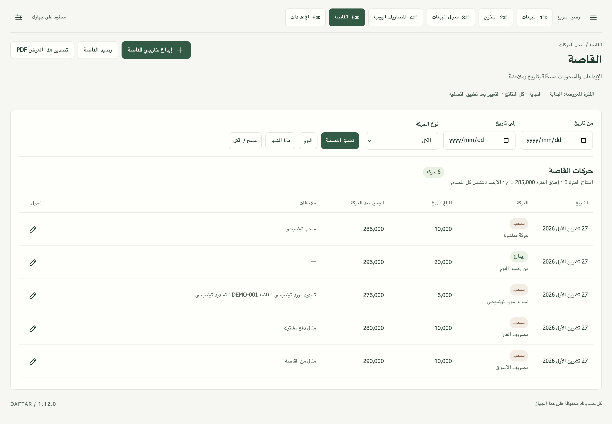
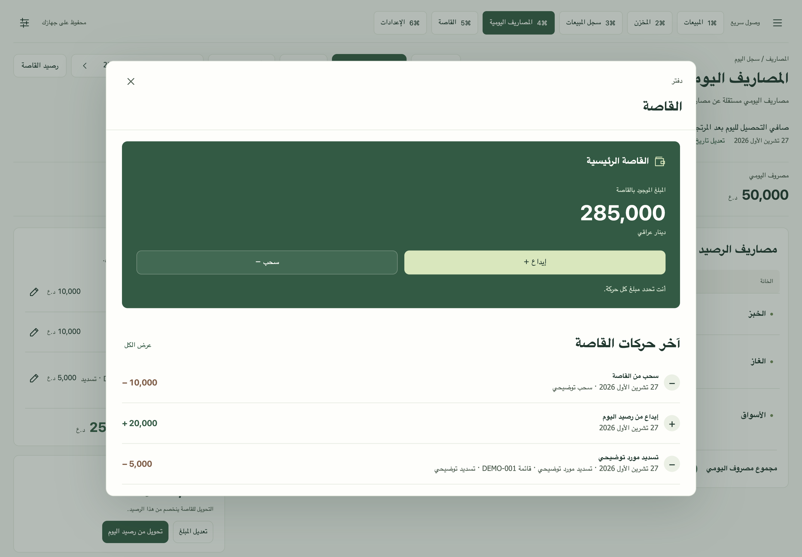

<!-- hindsight:ignore -->

> Historical 19-phase plan, superseded by the [current 12-phase plan](../../../README.md) on 2026-10-27. Do not use these phase numbers for new work.

# Phase 15 — Cashbox and daily transfers

Status: planned, not implemented. Date: 2026-10-27. Depends on: 02, 09, 14.

Outcome: Cash movements and transfers reconcile with the daily ledger.

[Master plan](../README.md) · [Screenshot gallery](../gallery.html?phase=15) · [Design contract](../design-system.md) · [Accounting contract](../accounting-parity.md)

## Work to deliver

- [ ] Rebuild cash card, movement ledger/running balance, filters, external deposit/withdrawal, edit/delete and cash context popover.
- [ ] Include derived cash-funded expense/payment movements without permitting a second independent edit of a derived movement; route to its source.
- [ ] Transfer part/all of available remaining daily cash to cashbox once. Editing/deleting restores both sides correctly and preserves the saved total-balance meaning.
- [ ] Keep existing negative-balance indications where the source allows them; do not introduce unapproved blocking rules or label cashbox balance as profit.

## Acceptance for this feature

- [ ] External deposits, withdrawals, shared expenses, payments and transfers reconcile to the model and filtered running balances.
- [ ] A transfer above available daily cash is blocked. Editing or deleting a transfer adjusts daily and cashbox once, with no expense created.

- [ ] Run this phase’s behavior tests with isolated synthetic records; save command/result evidence.
- [ ] Capture the implemented Flutter screen and dialogs on macOS, Android and iPhone; compare the same state and logical size against the references below.
- [ ] Verify empty, populated, invalid, loading, failed-save and retry/cancel states where applicable; test restart persistence for every changed record.
- [ ] Review with the owner at this phase. Preserve the current design unless an explicit change is recorded; an undecided edit does not authorize a redesign.
- [ ] Update feature coverage, decisions and the project log; synchronize project documentation and verify no pending/failed memory work.

## Screenshot references

These are current Electron screenshots with synthetic data, except the explicitly labelled design board and report HTML. They specify composition and current behavior; they do not prove a Flutter implementation. Phone captures are narrow current-UI references, not native Android/iPhone captures. See the capture contract before comparing pixels.

| Reference | Kind |
| --- | --- |
| [desktop-cash](../../../screenshots/desktop-cash.png) | Full viewport |
| [desktop-cash-popout](../../../screenshots/desktop-cash-popout.png) | Full viewport |
| [desktop-cash-deposit](../../../screenshots/desktop-cash-deposit.png) | Full viewport |
| [desktop-cash-withdrawal](../../../screenshots/desktop-cash-withdrawal.png) | Full viewport |
| [desktop-cash-edit](../../../screenshots/desktop-cash-edit.png) | Full viewport |
| [desktop-daily-transfer](../../../screenshots/desktop-daily-transfer.png) | Full viewport |
| [phone-cash](../../../screenshots/phone-cash.png) | Narrow viewport |
| [desktop-cash-edit-bottom](../../../screenshots/desktop-cash-edit-bottom.png) | Full viewport |
| [empty-cash](../../../screenshots/empty-cash.png) | Full viewport |
| [phone-cash-bottom](../../../screenshots/phone-cash-bottom.png) | Narrow viewport |
| [full-phone-cash](../../../screenshots/full-phone-cash.png) | Full document |
| [full-cash](../../../screenshots/full-cash.png) | Full document |

## Handoff for implementation

Read the master plan, this phase, its screenshot set and the linked source evidence. Implement phase 15 only after its dependencies are complete. First report any source/reference mismatch. Use the current design without additional features; ask for the owner’s phase-specific edits when beginning the work. Keep the Electron app and real records safe. End with the working feature, tests, Flutter screenshots, documented differences and updated completion evidence. Do not mark planned work as implemented.
