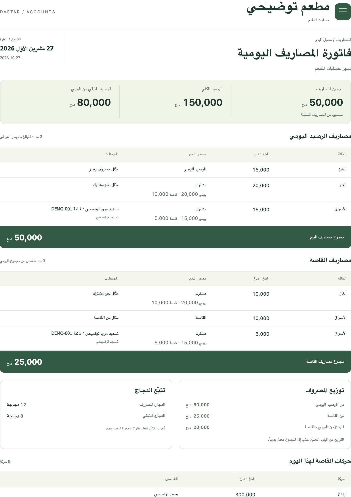
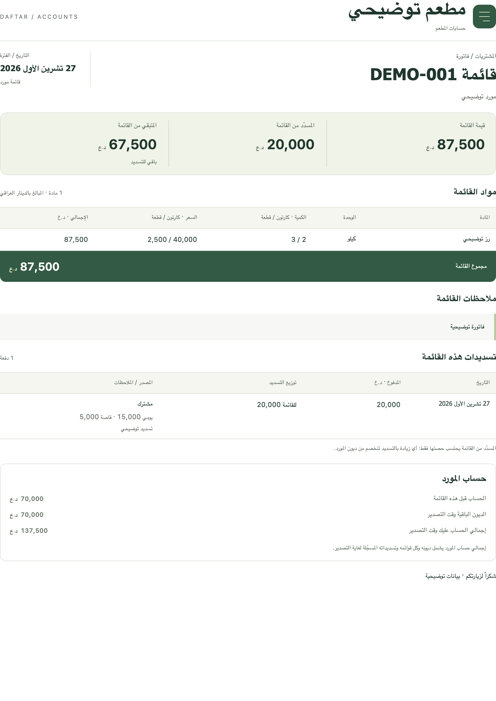

<!-- hindsight:ignore -->

> Historical 19-phase plan, superseded by the [current 12-phase plan](../../../README.md) on 2026-10-27. Do not use these phase numbers for new work.

# Phase 17 — Arabic PDF reports, sharing and system printing

Status: planned, not implemented. Date: 2026-10-27. Depends on: 06, 08, 10, 13, 14, 15, 16.

Outcome: Every current operational report can be exported/shared and printed through the system.

[Master plan](../README.md) · [Screenshot gallery](../gallery.html?phase=17) · [Design contract](../design-system.md) · [Accounting contract](../accounting-parity.md)

## Work to deliver

- [ ] Reproduce daily expenses, supplier invoice, sale receipt, period sales/refunds, account statement, cashbox and supplier-payment receipt. Retired worker reports remain compatibility code only, with no new visible workflow.
- [ ] Generate from validated saved records and stable IDs/filters, never user-provided HTML or editable display totals. Match Arabic shaping, RTL order, Latin numbers, A4 layout, table wrapping, page breaks, repeated headings and page numbering.
- [ ] Provide save/share/open actions on each target and normal system print dialogs. Cancel, denied file access, no printer and service failure leave the saved transaction intact.
- [ ] Use report HTML screenshots as content/style references, then render actual Flutter PDFs and inspect every page. HTML screenshots are not evidence of PDF output fidelity.
- [ ] No thermal printer/Bluetooth/ESC-POS work is included. Store signing, sharing and print integration evidence per platform.

## Acceptance for this feature

- [ ] Seven report kinds export from all three platforms; amounts and date/filter boundaries match on screen and in the file.
- [ ] Open/print/share is tested with native surfaces on physical devices; system print cancellation creates no new sale or payment. Arabic text is intact in short and multipage outputs.

- [ ] Run this phase’s behavior tests with isolated synthetic records; save command/result evidence.
- [ ] Capture the implemented Flutter screen and dialogs on macOS, Android and iPhone; compare the same state and logical size against the references below.
- [ ] Verify empty, populated, invalid, loading, failed-save and retry/cancel states where applicable; test restart persistence for every changed record.
- [ ] Review with the owner at this phase. Preserve the current design unless an explicit change is recorded; an undecided edit does not authorize a redesign.
- [ ] Update feature coverage, decisions and the project log; synchronize project documentation and verify no pending/failed memory work.

## Screenshot references

These are current Electron screenshots with synthetic data, except the explicitly labelled design board and report HTML. They specify composition and current behavior; they do not prove a Flutter implementation. Phone captures are narrow current-UI references, not native Android/iPhone captures. See the capture contract before comparing pixels.

| Reference | Kind |
| --- | --- |
| [report-daily](../../../screenshots/report-daily.png) | Full viewport |
| [report-invoice](../../../screenshots/report-invoice.png) | Full viewport |
| [report-sale](../../../screenshots/report-sale.png) | Full viewport |
| [report-sales](../../../screenshots/report-sales.png) | Full viewport |
| [report-statement](../../../screenshots/report-statement.png) | Full viewport |
| [report-cash](../../../screenshots/report-cash.png) | Full viewport |
| [report-payment](../../../screenshots/report-payment.png) | Full viewport |
| [report-daily-full](../../../screenshots/report-daily-full.png) | Full document |
| [report-invoice-full](../../../screenshots/report-invoice-full.png) | Full document |
| [report-sale-full](../../../screenshots/report-sale-full.png) | Full document |
| [report-sales-full](../../../screenshots/report-sales-full.png) | Full document |
| [report-statement-full](../../../screenshots/report-statement-full.png) | Full document |
| [report-cash-full](../../../screenshots/report-cash-full.png) | Full document |
| [report-payment-full](../../../screenshots/report-payment-full.png) | Full document |

## Handoff for implementation

Read the master plan, this phase, its screenshot set and the linked source evidence. Implement phase 17 only after its dependencies are complete. First report any source/reference mismatch. Use the current design without additional features; ask for the owner’s phase-specific edits when beginning the work. Keep the Electron app and real records safe. End with the working feature, tests, Flutter screenshots, documented differences and updated completion evidence. Do not mark planned work as implemented.
