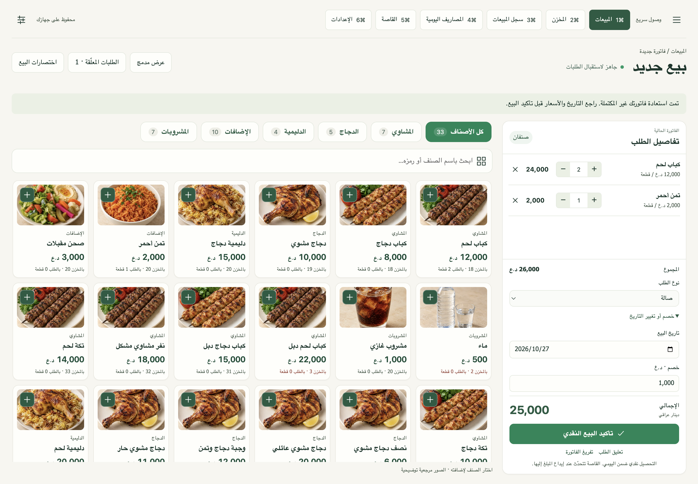
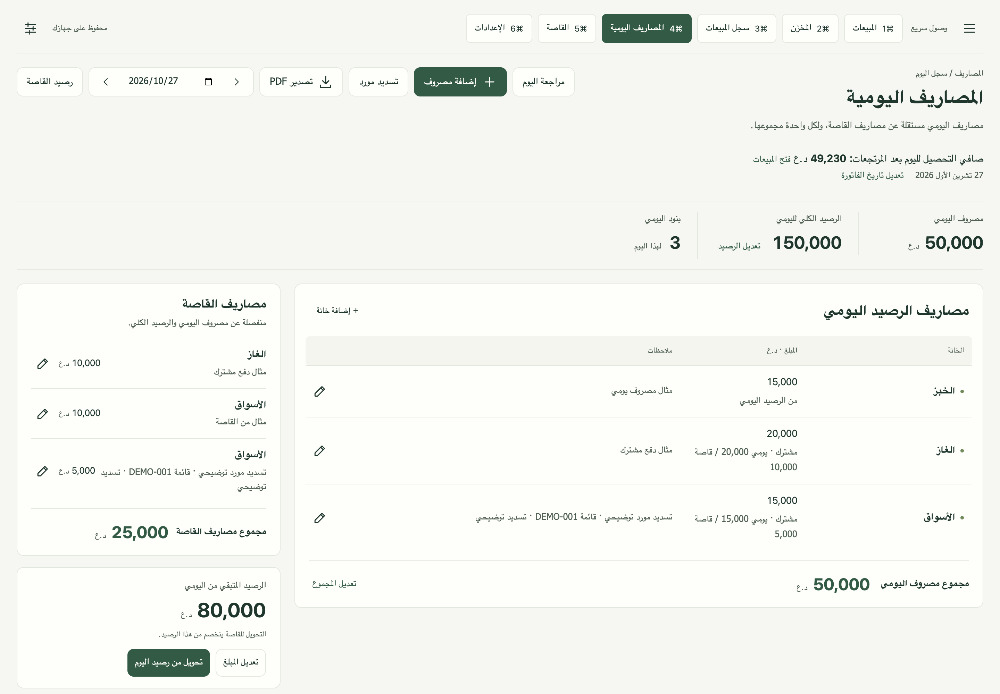

> Completion grouping, 2026-11-05: original 00 is a retained work package in the owner's single Completion phase. Carry unfinished requirements/evidence forward; preserve completed results. The detailed requirements below remain intact. [Current scope/readiness](../../../phases/completion-scope-readiness.md). Penpot and original-checkout/ordinary-branch rules supersede historical Figma/worktree instructions. This is Step 1 only.

# Phase 00 — Baseline and delivery setup

Status: approved technical baseline merged; native acceptance and explicit Penpot design approval remain pending. Updated: 2026-10-28. Depends on: None.

Outcome: A runnable, isolated Flutter app on macOS, Android and iPhone, with a frozen specification.

Includes former phase(s): 00. [Merge rationale and old-to-new map](../phase-map.md).

[Master plan](../README.md) · [Screenshot gallery](../gallery.html?phase=00) · [Design contract](../design-system.md) · [Accounting contract](../accounting-parity.md)

Execution rules: [AGENTS.md](../../../../AGENTS.md) · scope index: [PLANS.md](../../../../PLANS.md) · authoritative status/evidence: [PHASES.md](../../../../PHASES.md). This published scope file does not establish phase completion.

## Work to deliver

### Baseline and delivery setup

- [ ] Create the Flutter workspace at this project root, retaining the unchanged Electron reference in electron-reference/. Use separate development app identifiers and data locations until the final migration rehearsal.
- [ ] Pin the verified Flutter/Dart toolchain and dependency versions; record minimum supported OS versions and actual test devices. Build and launch a blank Arabic RTL shell on all three targets.
- [ ] Freeze these screenshots, source hashes, illustrative fixtures and feature inventory. Review the current plan with the owner; changes can be decided at the start of each later phase.
- [ ] Choose iPhone installation/distribution route, Apple signing identity, Android signing custody and macOS distribution route. Keep credentials outside the repository.
- [ ] Prove Arabic font availability/licensing, file picker import/export, local writes, PDF generation/share and system print entry points on all targets before depending on plugins. Select dependencies by this evidence, not by another project’s stack.

## Acceptance for this feature

Owner target direction, 2026-10-28: use the iPhone Simulator on this Mac for this run. Simulator functional evidence is accepted for the current execution target; physical iPhone installation/signing remains deferred, not passed. [Current build evidence](../../../phases/00-build-evidence.md).

- [ ] Three launch records show device/OS/build versions and screenshots. A simulator build alone does not establish iPhone installation.
- [ ] Every current screen and behavior has an owner phase. No current accounts have been opened, modified or migrated by this planning work.

- [ ] Run this phase’s behavior tests with isolated synthetic records; save command/result evidence.
- [ ] Capture the implemented Flutter screen and dialogs on macOS, Android and iPhone; compare the same state and logical size against the references below.
- [ ] Verify empty, populated, invalid, loading, failed-save and retry/cancel states where applicable; test restart persistence for every changed record.
- [ ] Review with the owner at this phase. Preserve the current design unless an explicit change is recorded; an undecided edit does not authorize a redesign.
- [ ] Update feature coverage, decisions and the project log; synchronize project documentation and verify no pending/failed memory work.
- [ ] Satisfy the adopted workflow: dedicated phase branch/worktree and PR, applicable Figma validation and user design approval (or Design: N/A), read-only planning, meaningful tests before behavior changes, independent review/re-verification and required CI/benchmark evidence.
- [ ] Record user approval, merged PR and applicable release/rollback validation in PHASES.md before marking DONE. Never merge without user approval or automatically start the next phase.

## Screenshot references

These are current Electron screenshots with synthetic data, except the explicitly labelled design board and report HTML. They specify composition and current behavior; they do not prove a Flutter implementation. Phone captures are narrow current-UI references, not native Android/iPhone captures. See the capture contract before comparing pixels.

| Reference | Kind |
| --- | --- |
| [desktop-sales](../screenshots/desktop-sales.png) | Full viewport |
| [desktop-expenses](../screenshots/desktop-expenses.png) | Full viewport |
| [desktop-settings-data](../screenshots/desktop-settings-data.png) | Full viewport |

## Handoff for implementation

Read AGENTS.md, PLANS.md, PHASES.md, the master plan, this phase, its screenshot set and source evidence. Implement phase 00 only when the owner has started it and its dependencies are complete. First report source/reference mismatches, establish dedicated Git isolation and apply the design/approval gate where relevant. The Lead coordinates a read-only Planner, appropriate UX/Workers and an independent Reviewer. Preserve the current design and scope. End with working results, actual tests/captures, review and PR evidence in PHASES.md. Do not mark DONE before approved merge and applicable release validation; do not automatically start the next phase.
