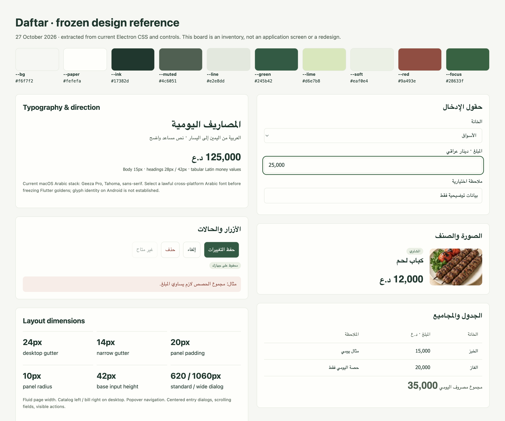
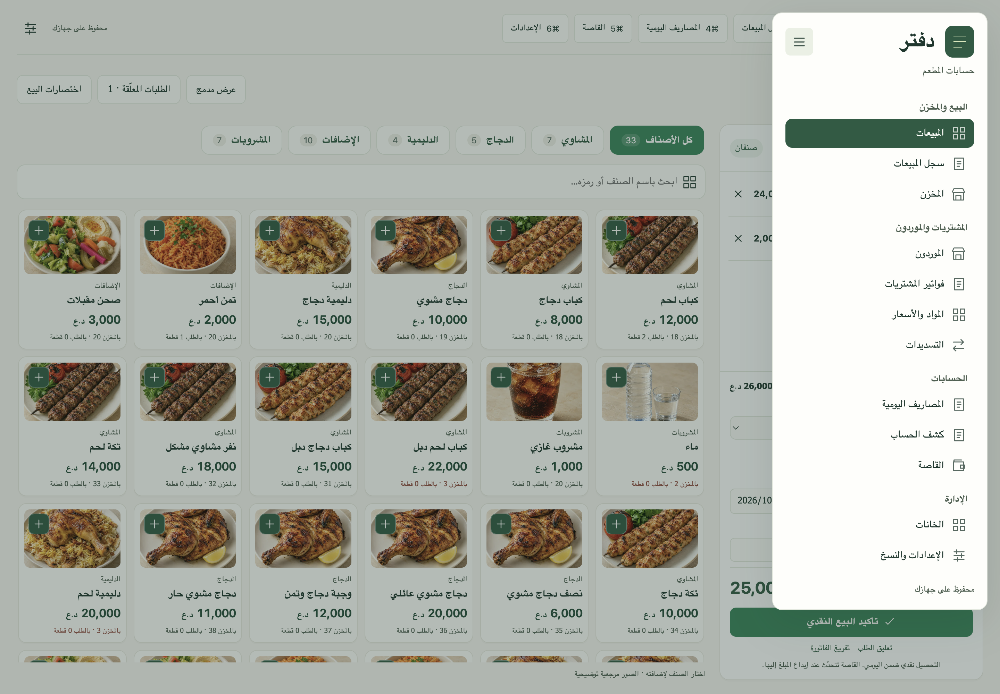

> Completion grouping, 2026-11-05: original 01 is a retained work package in the owner's single Completion phase. Approved Phase 01 DONE work is reused; only integration/regression obligations carry forward. The detailed requirements below remain intact. [Current scope/readiness](../../../phases/completion-scope-readiness.md). Penpot and original-checkout/ordinary-branch rules supersede historical Figma/worktree instructions. This is Step 1 only.

# Phase 01 — Design system, navigation and interaction shell

Status: planned, not implemented. Date: 2026-10-27. Depends on: 00.

Outcome: A responsive Arabic component system and complete navigation shell with shortcuts and safe form interactions.

Includes former phase(s): 01, 03. [Merge rationale and old-to-new map](../phase-map.md).

[Master plan](../README.md) · [Screenshot gallery](../gallery.html?phase=01) · [Design contract](../design-system.md) · [Accounting contract](../accounting-parity.md)

Execution rules: [AGENTS.md](../../../../AGENTS.md) · scope index: [PLANS.md](../../../../PLANS.md) · authoritative status/evidence: [PHASES.md](../../../../PHASES.md). This published scope file does not establish phase completion.

## Work to deliver

### Design system and responsive components

- [ ] Implement extracted colors, radii, spacing, page gutters, typography roles, Latin tabular financial values, Arabic labels and RTL reading order.
- [ ] Build the actual shared components: toolbar and shortcuts, buttons and icons, inputs, money/quantity/date fields, selects, tables, pagination, filters, badges, empty states, toast/status, standard and wide dialogs.
- [ ] Retain fluid full-width pages, catalog on the left and bill on the right, modest gutters, compact related totals, popover navigation and centered dialogs. Reuse the frozen product thumbnails and icon paths.
- [ ] Reproduce the current narrow reference at 390×844, then verify safe areas, keyboard open, scrollable form content, visible save/cancel, back gesture and large text on Android and iPhone.
- [ ] Choose a licensed Arabic font and establish a golden baseline per platform. Record glyph/rendering differences explicitly; do not claim raw macOS pixels can be identical on every platform.

### Navigation, shortcuts and interaction shell

- [ ] Rebuild the grouped popover menu and dismiss/scrim behavior, six configurable shortcuts, active state and current save/error status.
- [ ] Wire route restoration and unknown destinations back to Sales. Preserve the historic savings shortcut cleanup without exposing a retired screen.
- [ ] Implement keyboard traversal, Escape, focus trapping/restoration, menu shortcuts, session undo dispatch and dirty-form protection. Map mobile back/navigation onto the same rules.
- [ ] Provide compact loading, empty and failure shells without changing domain records. Keep every page aligned to the same gutters.

## Acceptance for this feature

- [ ] Component gallery screenshots cover default, focused, disabled, loading, validation and error states.
- [ ] Side-by-side comparison at the same logical size shows no unexplained layout or copy differences. 320-wide and 200% text tests leave essential actions reachable.
- [ ] Every route opens, closes and restores focus; hidden navigation cannot receive interaction.
- [ ] Unsaved dialogs/settings require a discard decision; canceling it retains content. Navigation does not erase an active ticket.

- [ ] Run this phase’s behavior tests with isolated synthetic records; save command/result evidence.
- [ ] Capture the implemented Flutter screen and dialogs on macOS, Android and iPhone; compare the same state and logical size against the references below.
- [ ] Verify empty, populated, invalid, loading, failed-save and retry/cancel states where applicable; test restart persistence for every changed record.
- [ ] Review with the owner at this phase. Preserve the current design unless an explicit change is recorded; an undecided edit does not authorize a redesign.
- [ ] Update feature coverage, decisions and the project log; synchronize project documentation and verify no pending/failed memory work.
- [ ] Satisfy the adopted workflow: dedicated phase branch/worktree and PR, applicable Figma validation and user design approval (or Design: N/A), read-only planning, meaningful tests before behavior changes, independent review/re-verification and required CI/benchmark evidence.
- [ ] Record user approval, merged PR and applicable release/rollback validation in PHASES.md before marking DONE. Never merge without user approval or automatically start the next phase.

## Screenshot references

These are current Electron screenshots with synthetic data, except the explicitly labelled design board and report HTML. They specify composition and current behavior; they do not prove a Flutter implementation. Phone captures are narrow current-UI references, not native Android/iPhone captures. See the capture contract before comparing pixels.

| Reference | Kind |
| --- | --- |
| [design-system](../screenshots/design-system.png) | Full viewport |
| [desktop-navigation](../screenshots/desktop-navigation.png) | Full viewport |
| [desktop-invoice-new](../screenshots/desktop-invoice-new.png) | Full viewport |
| [phone-invoice-new](../screenshots/phone-invoice-new.png) | Narrow viewport |
| [desktop-sales](../screenshots/desktop-sales.png) | Full viewport |
| [phone-sales](../screenshots/phone-sales.png) | Narrow viewport |

## Handoff for implementation

Read AGENTS.md, PLANS.md, PHASES.md, the master plan, this phase, its screenshot set and source evidence. Implement phase 01 only when the owner has started it and its dependencies are complete. First report source/reference mismatches, establish dedicated Git isolation and apply the design/approval gate where relevant. The Lead coordinates a read-only Planner, appropriate UX/Workers and an independent Reviewer. Preserve the current design and scope. End with working results, actual tests/captures, review and PR evidence in PHASES.md. Do not mark DONE before approved merge and applicable release validation; do not automatically start the next phase.
