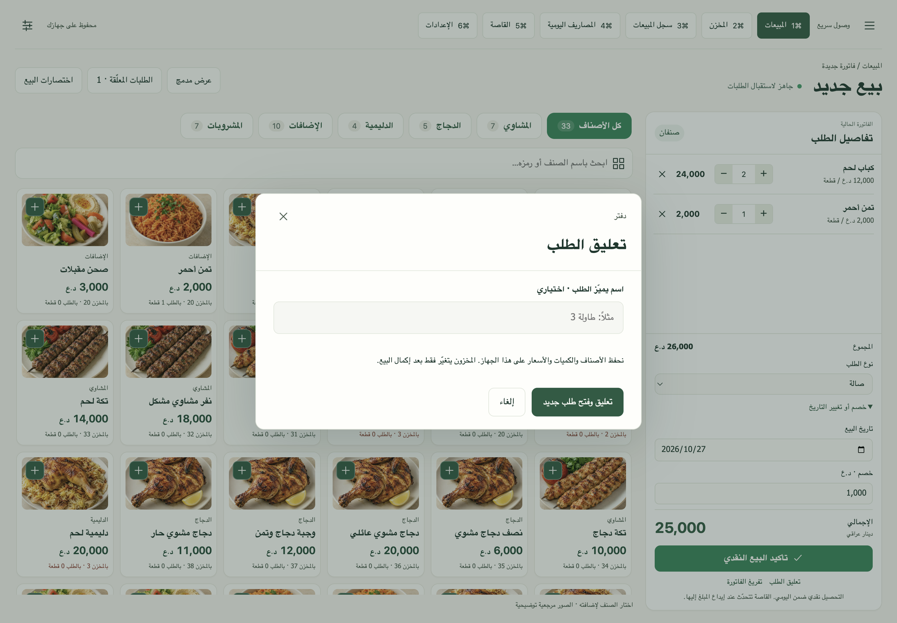

> Completion grouping, 2026-11-05: original 04 is a retained work package in the owner's single Completion phase. Carry unfinished requirements/evidence forward; preserve completed results. The detailed requirements below remain intact. [Current scope/readiness](../../../phases/completion-scope-readiness.md). Penpot and original-checkout/ordinary-branch rules supersede historical Figma/worktree instructions. This is Step 1 only.

# Phase 04 — Cash sales, saved receipt, drafts and held orders

Status: planned, not implemented. Date: 2026-10-27. Depends on: 01, 02, 03.

Outcome: A cashier can build, suspend, recover and complete a ticket safely, with a saved receipt and one stock/cash effect.

Includes former phase(s): 06, 07. [Merge rationale and old-to-new map](../phase-map.md).

[Master plan](../README.md) · [Screenshot gallery](../gallery.html?phase=04) · [Design contract](../design-system.md) · [Accounting contract](../accounting-parity.md)

Execution rules: [AGENTS.md](../../../../AGENTS.md) · scope index: [PLANS.md](../../../../PLANS.md) · authoritative status/evidence: [PHASES.md](../../../../PHASES.md). This published scope file does not establish phase completion.

## Work to deliver

### Cash sale and saved receipt

- [ ] Reproduce photo cards, corner plus/count, group tabs/counts, search, compact display toggle and catalog pagination/scrolling.
- [ ] Build the right-hand ticket with quantity increment/decrement/direct entry, remove line, fixed discount, note, date, order type, subtotal and total; retain the price captured when adding an item.
- [ ] Exact-value checkout means confirming receipt of the net total. Do not add a tendered-cash input, taxes, fees, credit customers or automatic delivery charges.
- [ ] Persist before presenting the paid receipt. Protect duplicate taps, retries and stale workspace writes using durable operation/sale identity. Keep the ticket on any failed validation or save.
- [ ] After a successful save open the paid receipt with close/new-order, details, PDF and system-print actions. Connect file/print services incrementally; their final cross-platform completion is phase 10.

### Active draft and held orders

- [ ] Rebuild hold-name dialog, held list, resume/swap and deletion confirmation, including empty list.
- [ ] Persist active ticket and up to the source limit of 40 held orders in device/account-scoped storage; keep lines, price snapshots, date, discount, note and order type.
- [ ] A held order creates neither sale nor stock reservation nor cash effect. Resume checks current product availability at checkout.
- [ ] Switching to another held ticket atomically preserves the current one; handle storage failure and stale second-window state without losing either ticket.
- [ ] Keep these drafts outside the transferable accounts backup, matching current behavior. Explain their device-only boundary in the UI and manual.

## Acceptance for this feature

- [ ] Subtotal minus discount equals stored net; stock and daily sales change once. Retrying after restart cannot duplicate a saved sale or reuse a sale number.
- [ ] Empty ticket, insufficient stock, archived product, invalid discount and changed date have explicit states. Failed saves retain the ticket.
- [ ] Force-close/reopen recovers active and held orders, scoped to the correct account.
- [ ] Hold/resume failures preserve both sides; checkout conflicts cannot duplicate sales. Importing replacement accounts cannot resurrect unrelated drafts.

- [ ] Run this phase’s behavior tests with isolated synthetic records; save command/result evidence.
- [ ] Capture the implemented Flutter screen and dialogs on macOS, Android and iPhone; compare the same state and logical size against the references below.
- [ ] Verify empty, populated, invalid, loading, failed-save and retry/cancel states where applicable; test restart persistence for every changed record.
- [ ] Review with the owner at this phase. Preserve the current design unless an explicit change is recorded; an undecided edit does not authorize a redesign.
- [ ] Update feature coverage, decisions and the project log; synchronize project documentation and verify no pending/failed memory work.
- [ ] Satisfy the adopted workflow: dedicated phase branch/worktree and PR, applicable Figma validation and user design approval (or Design: N/A), read-only planning, meaningful tests before behavior changes, independent review/re-verification and required CI/benchmark evidence.
- [ ] Record user approval, merged PR and applicable release/rollback validation in PHASES.md before marking DONE. Never merge without user approval or automatically start the next phase.

## Screenshot references

These are current Electron screenshots with synthetic data, except the explicitly labelled design board and report HTML. They specify composition and current behavior; they do not prove a Flutter implementation. Phone captures are narrow current-UI references, not native Android/iPhone captures. See the capture contract before comparing pixels.

| Reference | Kind |
| --- | --- |
| [desktop-sales](../screenshots/desktop-sales.png) | Full viewport |
| [desktop-sales-cart](../screenshots/desktop-sales-cart.png) | Full viewport |
| [desktop-sales-compact](../screenshots/desktop-sales-compact.png) | Full viewport |
| [desktop-sales-catalog-bottom](../screenshots/desktop-sales-catalog-bottom.png) | Full viewport |
| [desktop-sales-no-results](../screenshots/desktop-sales-no-results.png) | Full viewport |
| [desktop-sale-paid](../screenshots/desktop-sale-paid.png) | Full viewport |
| [phone-sales](../screenshots/phone-sales.png) | Narrow viewport |
| [desktop-hold-order](../screenshots/desktop-hold-order.png) | Full viewport |
| [desktop-held-orders](../screenshots/desktop-held-orders.png) | Full viewport |
| [empty-sales](../screenshots/empty-sales.png) | Full viewport |
| [phone-sales-bottom](../screenshots/phone-sales-bottom.png) | Narrow viewport |
| [phone-sales-cart](../screenshots/phone-sales-cart.png) | Narrow viewport |
| [phone-sales-cart-bottom](../screenshots/phone-sales-cart-bottom.png) | Narrow viewport |
| [full-phone-sales](../screenshots/full-phone-sales.png) | Full document |
| [full-sales](../screenshots/full-sales.png) | Full document |

## Handoff for implementation

Read AGENTS.md, PLANS.md, PHASES.md, the master plan, this phase, its screenshot set and source evidence. Implement phase 04 only when the owner has started it and its dependencies are complete. First report source/reference mismatches, establish dedicated Git isolation and apply the design/approval gate where relevant. The Lead coordinates a read-only Planner, appropriate UX/Workers and an independent Reviewer. Preserve the current design and scope. End with working results, actual tests/captures, review and PR evidence in PHASES.md. Do not mark DONE before approved merge and applicable release validation; do not automatically start the next phase.
