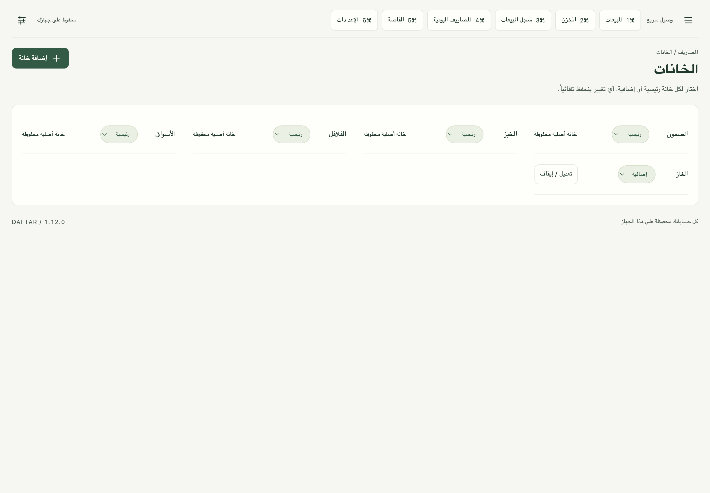
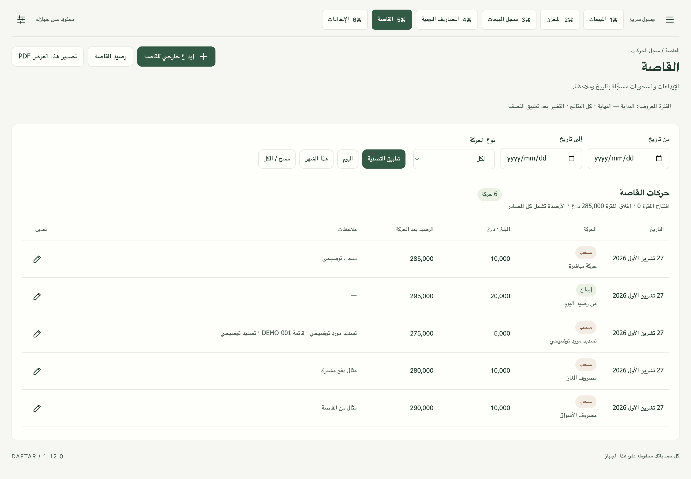

> Completion grouping, 2026-11-05: original 06 is a retained work package in the owner's single Completion phase. Carry unfinished requirements/evidence forward; preserve completed results. The detailed requirements below remain intact. [Current scope/readiness](../../../phases/completion-scope-readiness.md). Penpot and original-checkout/ordinary-branch rules supersede historical Figma/worktree instructions. This is Step 1 only.

# Phase 06 — Daily accounting, expense categories and cashbox

Status: planned, not implemented. Date: 2026-10-27. Depends on: 01, 02, 05.

Outcome: Categories, source-funded expenses, daily balances, chicken counts, cash movements and daily-to-cashbox transfers reconcile as one workflow.

Includes former phase(s): 04, 09, 15. [Merge rationale and old-to-new map](../phase-map.md).

[Master plan](../README.md) · [Screenshot gallery](../gallery.html?phase=06) · [Design contract](../design-system.md) · [Accounting contract](../accounting-parity.md)

Execution rules: [AGENTS.md](../../../../AGENTS.md) · scope index: [PLANS.md](../../../../PLANS.md) · authoritative status/evidence: [PHASES.md](../../../../PHASES.md). This published scope file does not establish phase completion.

## Work to deliver

### Expense categories

- [ ] Rebuild the category grid, add/edit dialog, primary/additional classification and automatic type save.
- [ ] Preserve built-in category identities and restrictions. Validate names and duplicate handling; allow custom category archive/restore behavior as supported by the source.
- [ ] Expose active categories to new expenses and supplier-payment defaults while historical entries keep their category identity. Support creating a category within the expense form.

### Daily expenses, remaining cash and chicken counts

- [ ] Reproduce the daily table plus compact secondary cash-expense/remaining/chicken column; date selection, previous/next/today, expense add/edit/delete and notes.
- [ ] Implement daily/cash/shared funding with both shares validated. A shared expense appears in both source views, with no duplication in daily totals.
- [ ] Port remaining-cash snapshots and total-balance recording, automatic/manual expense totals, correction reasons/history, clear balance and session undo preserving inverse correction records.
- [ ] Port daily date correction and optional shift of following recorded days with preview/collision protection. Respect the independent dates of supplier invoices/debts, sales and inventory.
- [ ] Chicken used/left are counts only. Keep daily sales/refunds integrated with remaining snapshots without treating balances as profit.

### Cashbox and daily transfers

- [ ] Rebuild cash card, movement ledger/running balance, filters, external deposit/withdrawal, edit/delete and cash context popover.
- [ ] Include derived cash-funded expense/payment movements without permitting a second independent edit of a derived movement; route to its source.
- [ ] Transfer part/all of available remaining daily cash to cashbox once. Editing/deleting restores both sides correctly and preserves the saved total-balance meaning.
- [ ] Keep existing negative-balance indications where the source allows them; do not introduce unapproved blocking rules or label cashbox balance as profit.

- [ ] Validate payment-derived expense/cash effects with synthetic saved payment records here; phase 08 must also prove the live invoice/payment UI updates these same ledgers once.

## Acceptance for this feature

- [ ] Add/edit/type/archive/reopen work offline and survive restart.
- [ ] Existing expenses and supplier references retain their identity and financial values; invalid names do not save.
- [ ] The numerical examples in accounting-parity.md pass for edits/deletes, shared funding, snapshots, later sales/refunds and transfers.
- [ ] Correction/undo/date-shift tests preserve linked records and reject overlaps; chicken changes affect no monetary result.
- [ ] External deposits, withdrawals, shared expenses, payments and transfers reconcile to the model and filtered running balances.
- [ ] A transfer above available daily cash is blocked. Editing or deleting a transfer adjusts daily and cashbox once, with no expense created.

- [ ] Run this phase’s behavior tests with isolated synthetic records; save command/result evidence.
- [ ] Capture the implemented Flutter screen and dialogs on macOS, Android and iPhone; compare the same state and logical size against the references below.
- [ ] Verify empty, populated, invalid, loading, failed-save and retry/cancel states where applicable; test restart persistence for every changed record.
- [ ] Review with the owner at this phase. Preserve the current design unless an explicit change is recorded; an undecided edit does not authorize a redesign.
- [ ] Update feature coverage, decisions and the project log; synchronize project documentation and verify no pending/failed memory work.
- [ ] Satisfy the adopted workflow: dedicated phase branch/worktree and PR, applicable Figma validation and user design approval (or Design: N/A), read-only planning, meaningful tests before behavior changes, independent review/re-verification and required CI/benchmark evidence.
- [ ] Record user approval, merged PR and applicable release/rollback validation in PHASES.md before marking DONE. Never merge without user approval or automatically start the next phase.

## Screenshot references

These are current Electron screenshots with synthetic data, except the explicitly labelled design board and report HTML. They specify composition and current behavior; they do not prove a Flutter implementation. Phone captures are narrow current-UI references, not native Android/iPhone captures. See the capture contract before comparing pixels.

| Reference | Kind |
| --- | --- |
| [desktop-categories](../screenshots/desktop-categories.png) | Full viewport |
| [desktop-category-new](../screenshots/desktop-category-new.png) | Full viewport |
| [desktop-category-edit](../screenshots/desktop-category-edit.png) | Full viewport |
| [phone-categories](../screenshots/phone-categories.png) | Narrow viewport |
| [desktop-expenses](../screenshots/desktop-expenses.png) | Full viewport |
| [desktop-expense-new](../screenshots/desktop-expense-new.png) | Full viewport |
| [desktop-expense-edit](../screenshots/desktop-expense-edit.png) | Full viewport |
| [desktop-validation](../screenshots/desktop-validation.png) | Full viewport |
| [desktop-remaining](../screenshots/desktop-remaining.png) | Full viewport |
| [desktop-total](../screenshots/desktop-total.png) | Full viewport |
| [desktop-balance](../screenshots/desktop-balance.png) | Full viewport |
| [desktop-day-date](../screenshots/desktop-day-date.png) | Full viewport |
| [desktop-chicken](../screenshots/desktop-chicken.png) | Full viewport |
| [phone-expenses](../screenshots/phone-expenses.png) | Narrow viewport |
| [desktop-cash](../screenshots/desktop-cash.png) | Full viewport |
| [desktop-cash-popout](../screenshots/desktop-cash-popout.png) | Full viewport |
| [desktop-cash-deposit](../screenshots/desktop-cash-deposit.png) | Full viewport |
| [desktop-cash-withdrawal](../screenshots/desktop-cash-withdrawal.png) | Full viewport |
| [desktop-cash-edit](../screenshots/desktop-cash-edit.png) | Full viewport |
| [desktop-daily-transfer](../screenshots/desktop-daily-transfer.png) | Full viewport |
| [phone-cash](../screenshots/phone-cash.png) | Narrow viewport |
| [desktop-expenses-bottom](../screenshots/desktop-expenses-bottom.png) | Full viewport |
| [desktop-expense-edit-bottom](../screenshots/desktop-expense-edit-bottom.png) | Full viewport |
| [desktop-cash-edit-bottom](../screenshots/desktop-cash-edit-bottom.png) | Full viewport |
| [empty-expenses](../screenshots/empty-expenses.png) | Full viewport |
| [empty-cash](../screenshots/empty-cash.png) | Full viewport |
| [empty-categories](../screenshots/empty-categories.png) | Full viewport |
| [phone-expenses-bottom](../screenshots/phone-expenses-bottom.png) | Narrow viewport |
| [phone-cash-bottom](../screenshots/phone-cash-bottom.png) | Narrow viewport |
| [phone-categories-bottom](../screenshots/phone-categories-bottom.png) | Narrow viewport |
| [phone-expense-new](../screenshots/phone-expense-new.png) | Narrow viewport |
| [phone-expense-new-bottom](../screenshots/phone-expense-new-bottom.png) | Narrow viewport |
| [full-phone-expenses](../screenshots/full-phone-expenses.png) | Full document |
| [full-phone-cash](../screenshots/full-phone-cash.png) | Full document |
| [full-phone-categories](../screenshots/full-phone-categories.png) | Full document |
| [full-expenses](../screenshots/full-expenses.png) | Full document |
| [full-cash](../screenshots/full-cash.png) | Full document |
| [full-categories](../screenshots/full-categories.png) | Full document |

## Handoff for implementation

Read AGENTS.md, PLANS.md, PHASES.md, the master plan, this phase, its screenshot set and source evidence. Implement phase 06 only when the owner has started it and its dependencies are complete. First report source/reference mismatches, establish dedicated Git isolation and apply the design/approval gate where relevant. The Lead coordinates a read-only Planner, appropriate UX/Workers and an independent Reviewer. Preserve the current design and scope. End with working results, actual tests/captures, review and PR evidence in PHASES.md. Do not mark DONE before approved merge and applicable release validation; do not automatically start the next phase.
