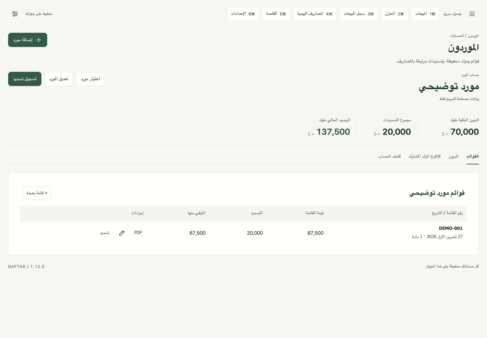
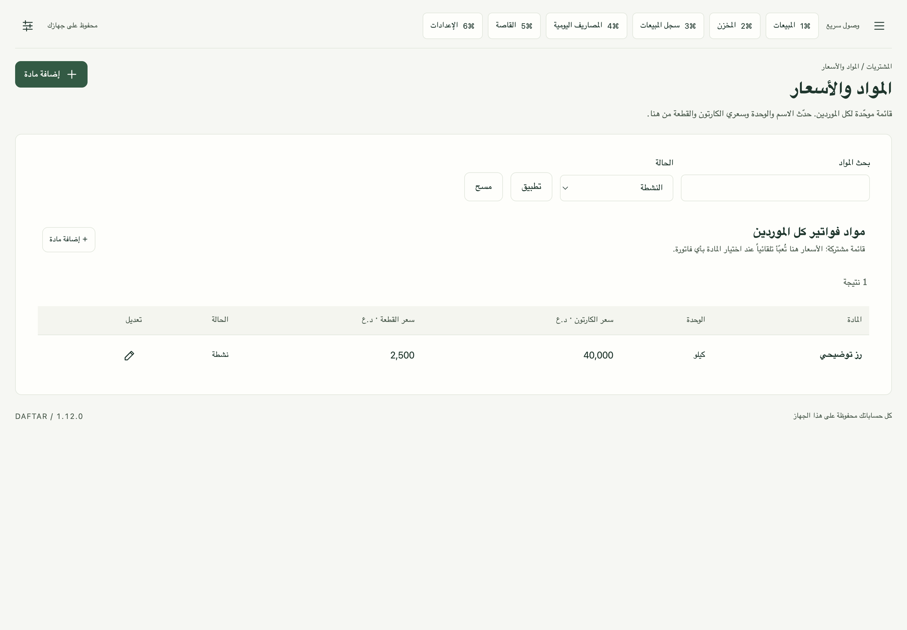

> Completion grouping, 2026-11-05: original 07 is a retained work package in the owner's single Completion phase. Carry unfinished requirements/evidence forward; preserve completed results. The detailed requirements below remain intact. [Current scope/readiness](../../../phases/completion-scope-readiness.md). Penpot and original-checkout/ordinary-branch rules supersede historical Figma/worktree instructions. This is Step 1 only.

# Phase 07 — Suppliers, debts, materials and prices

Status: planned, not implemented. Date: 2026-10-27. Depends on: 01, 02, 06.

Outcome: Supplier liabilities and a shared materials/default-price catalog are ready for purchasing.

Includes former phase(s): 11, 12. [Merge rationale and old-to-new map](../phase-map.md).

[Master plan](../README.md) · [Screenshot gallery](../gallery.html?phase=07) · [Design contract](../design-system.md) · [Accounting contract](../accounting-parity.md)

Execution rules: [AGENTS.md](../../../../AGENTS.md) · scope index: [PLANS.md](../../../../PLANS.md) · authoritative status/evidence: [PHASES.md](../../../../PHASES.md). This published scope file does not establish phase completion.

## Work to deliver

### Suppliers, opening balances and debts

- [ ] Rebuild supplier picker/search, supplier add/edit, optional contact and note, category default, opening debt and supported archive behavior.
- [ ] Reproduce supplier summary, invoices/debts/ledger tabs, additional debt add/edit/delete and chronological before/after balances.
- [ ] Preserve IDs and relationships and enforce restrictions on debt reductions/deletions once allocated payments exist.
- [ ] Opening debt, added debt and invoice liability do not themselves create paid expense or cashbox movements. Payment actions link to phase 08.

### Shared supplier materials and default prices

- [ ] Reproduce material search/status filters, add/edit/archive, name, unit and independent carton/piece defaults.
- [ ] Keep one shared catalog across suppliers. Selecting a material fills defaults in a new invoice but saves a snapshot on that invoice.
- [ ] Preserve legacy material identity/migration and duplicate-name handling. Do not infer a carton-to-piece conversion.

## Acceptance for this feature

- [ ] Opening debt + added debt + invoices − payments equals the supplier summary and ledger closing balance.
- [ ] Backdated debt/invoice changes and payment allocations preserve history and reject underfunded edits.
- [ ] Editing or archiving a material never rewrites an earlier invoice or debt total.
- [ ] New invoice selection uses current defaults, while legacy single-unit lines remain readable and retain totals.

- [ ] Run this phase’s behavior tests with isolated synthetic records; save command/result evidence.
- [ ] Capture the implemented Flutter screen and dialogs on macOS, Android and iPhone; compare the same state and logical size against the references below.
- [ ] Verify empty, populated, invalid, loading, failed-save and retry/cancel states where applicable; test restart persistence for every changed record.
- [ ] Review with the owner at this phase. Preserve the current design unless an explicit change is recorded; an undecided edit does not authorize a redesign.
- [ ] Update feature coverage, decisions and the project log; synchronize project documentation and verify no pending/failed memory work.
- [ ] Satisfy the adopted workflow: dedicated phase branch/worktree and PR, applicable Figma validation and user design approval (or Design: N/A), read-only planning, meaningful tests before behavior changes, independent review/re-verification and required CI/benchmark evidence.
- [ ] Record user approval, merged PR and applicable release/rollback validation in PHASES.md before marking DONE. Never merge without user approval or automatically start the next phase.

## Screenshot references

These are current Electron screenshots with synthetic data, except the explicitly labelled design board and report HTML. They specify composition and current behavior; they do not prove a Flutter implementation. Phone captures are narrow current-UI references, not native Android/iPhone captures. See the capture contract before comparing pixels.

| Reference | Kind |
| --- | --- |
| [desktop-suppliers](../screenshots/desktop-suppliers.png) | Full viewport |
| [desktop-supplier-picker](../screenshots/desktop-supplier-picker.png) | Full viewport |
| [desktop-supplier-new](../screenshots/desktop-supplier-new.png) | Full viewport |
| [desktop-supplier-edit](../screenshots/desktop-supplier-edit.png) | Full viewport |
| [desktop-supplier-debts](../screenshots/desktop-supplier-debts.png) | Full viewport |
| [desktop-supplier-ledger](../screenshots/desktop-supplier-ledger.png) | Full viewport |
| [desktop-debt](../screenshots/desktop-debt.png) | Full viewport |
| [phone-suppliers](../screenshots/phone-suppliers.png) | Narrow viewport |
| [desktop-materials](../screenshots/desktop-materials.png) | Full viewport |
| [desktop-material-new](../screenshots/desktop-material-new.png) | Full viewport |
| [desktop-material-edit](../screenshots/desktop-material-edit.png) | Full viewport |
| [phone-materials](../screenshots/phone-materials.png) | Narrow viewport |
| [desktop-supplier-edit-bottom](../screenshots/desktop-supplier-edit-bottom.png) | Full viewport |
| [empty-suppliers](../screenshots/empty-suppliers.png) | Full viewport |
| [empty-materials](../screenshots/empty-materials.png) | Full viewport |
| [phone-suppliers-bottom](../screenshots/phone-suppliers-bottom.png) | Narrow viewport |
| [phone-materials-bottom](../screenshots/phone-materials-bottom.png) | Narrow viewport |
| [full-phone-suppliers](../screenshots/full-phone-suppliers.png) | Full document |
| [full-phone-materials](../screenshots/full-phone-materials.png) | Full document |
| [full-suppliers](../screenshots/full-suppliers.png) | Full document |
| [full-materials](../screenshots/full-materials.png) | Full document |

## Handoff for implementation

Read AGENTS.md, PLANS.md, PHASES.md, the master plan, this phase, its screenshot set and source evidence. Implement phase 07 only when the owner has started it and its dependencies are complete. First report source/reference mismatches, establish dedicated Git isolation and apply the design/approval gate where relevant. The Lead coordinates a read-only Planner, appropriate UX/Workers and an independent Reviewer. Preserve the current design and scope. End with working results, actual tests/captures, review and PR evidence in PHASES.md. Do not mark DONE before approved merge and applicable release validation; do not automatically start the next phase.
