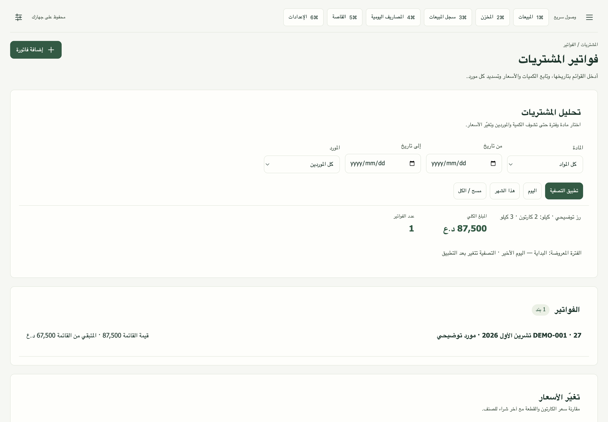
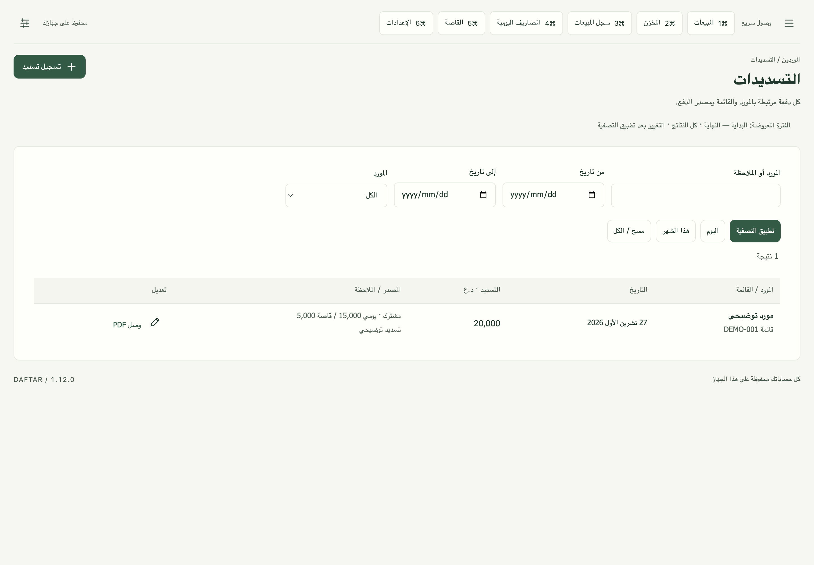

# Phase 08 — Purchase invoices, analysis and supplier payments

Status: planned, not implemented. Date: 2026-10-27. Depends on: 02, 06, 07.

Outcome: Invoices, quantity/price analysis and partial/full settlement work together, including atomic invoice-with-payment.

Includes former phase(s): 13, 14. [Merge rationale and old-to-new map](../phase-map.md).

[Master plan](../README.md) · [Screenshot gallery](../gallery.html?phase=08) · [Design contract](../design-system.md) · [Accounting contract](../accounting-parity.md)

Execution rules: [AGENTS.md](../../../../AGENTS.md) · scope index: [PLANS.md](../../../../PLANS.md) · authoritative status/evidence: [PHASES.md](../../../../PHASES.md). This published scope file does not establish phase completion.

## Work to deliver

### Purchase invoices and purchase analysis

- [ ] Rebuild separate purchase-invoice page, supplier/material/date filters, purchase groups/details and quantity/price history comparisons.
- [ ] Reproduce the wide invoice dialog with visible supplier/date/number context, scrollable lines and total/save actions. Support adding/selecting materials inline.
- [ ] Enter carton and piece quantities/prices independently; save snapshots and notes. Permit historical invoices with unique invoice number per supplier.
- [ ] Create liability only for an unpaid invoice. Invoice-with-payment must commit the invoice and payment together, using this phase’s allocation/funding rules; both invoice and immediate payment must work before this phase is complete.
- [ ] Restrict edit/delete when payments exist. Preserve legacy quantity × unit-price lines and unit-aware analysis.

### Supplier payments and allocation

- [ ] Rebuild payments list/filter/pagination and new/edit/delete payment dialog, supplier/invoice/debt choice, amount/date/category/note and funding split.
- [ ] Implement available amount and preview: pay the selected invoice first, then eligible supplier debt; store invoiceAmount and debtAmount.
- [ ] Never spill excess into another invoice or future debt. Prevent orphan references, wrong supplier, invalid payment date and overpayment.
- [ ] Connect purchase-with-immediate-payment atomically. A payment contributes one paid expense and one source effect; editing/deleting reverses prior effects appropriately.
- [ ] Provide payment receipt PDF entry; complete platform sharing in phase 10.

## Acceptance for this feature

- [ ] Carton/piece calculations match rounding and range limits; quantities aggregate by unit without fabricated conversion.
- [ ] Paid invoices cannot be deleted or reduced below their allocation. Inline material creation plus invoice save is atomic.
- [ ] The invoice/debt split and daily/cash split reconcile through restart/import/edit/delete and backdated operations.
- [ ] Invoice + immediate payment either both save or neither saves. No path double-counts expense or deducts the source twice.

- [ ] Run this phase’s behavior tests with isolated synthetic records; save command/result evidence.
- [ ] Capture the implemented Flutter screen and dialogs on macOS, Android and iPhone; compare the same state and logical size against the references below.
- [ ] Verify empty, populated, invalid, loading, failed-save and retry/cancel states where applicable; test restart persistence for every changed record.
- [ ] Review with the owner at this phase. Preserve the current design unless an explicit change is recorded; an undecided edit does not authorize a redesign.
- [ ] Update feature coverage, decisions and the project log; synchronize project documentation and verify no pending/failed memory work.
- [ ] Satisfy the adopted workflow: dedicated phase branch/worktree and PR, applicable Figma validation and user design approval (or Design: N/A), read-only planning, meaningful tests before behavior changes, independent review/re-verification and required CI/benchmark evidence.
- [ ] Record user approval, merged PR and applicable release/rollback validation in PHASES.md before marking DONE. Never merge without user approval or automatically start the next phase.

## Screenshot references

These are current Electron screenshots with synthetic data, except the explicitly labelled design board and report HTML. They specify composition and current behavior; they do not prove a Flutter implementation. Phone captures are narrow current-UI references, not native Android/iPhone captures. See the capture contract before comparing pixels.

| Reference | Kind |
| --- | --- |
| [desktop-invoices](../screenshots/desktop-invoices.png) | Full viewport |
| [desktop-invoice-new](../screenshots/desktop-invoice-new.png) | Full viewport |
| [desktop-invoice-new-bottom](../screenshots/desktop-invoice-new-bottom.png) | Full viewport |
| [desktop-invoice-edit](../screenshots/desktop-invoice-edit.png) | Full viewport |
| [phone-invoice-new](../screenshots/phone-invoice-new.png) | Narrow viewport |
| [desktop-payments](../screenshots/desktop-payments.png) | Full viewport |
| [desktop-payment-new](../screenshots/desktop-payment-new.png) | Full viewport |
| [desktop-payment-edit](../screenshots/desktop-payment-edit.png) | Full viewport |
| [phone-payment-new](../screenshots/phone-payment-new.png) | Narrow viewport |
| [desktop-invoices-bottom](../screenshots/desktop-invoices-bottom.png) | Full viewport |
| [desktop-invoice-edit-bottom](../screenshots/desktop-invoice-edit-bottom.png) | Full viewport |
| [desktop-payment-new-bottom](../screenshots/desktop-payment-new-bottom.png) | Full viewport |
| [desktop-payment-edit-bottom](../screenshots/desktop-payment-edit-bottom.png) | Full viewport |
| [desktop-invoice-cartons](../screenshots/desktop-invoice-cartons.png) | Full viewport |
| [empty-invoices](../screenshots/empty-invoices.png) | Full viewport |
| [empty-payments](../screenshots/empty-payments.png) | Full viewport |
| [phone-invoices](../screenshots/phone-invoices.png) | Narrow viewport |
| [phone-invoices-bottom](../screenshots/phone-invoices-bottom.png) | Narrow viewport |
| [phone-payments](../screenshots/phone-payments.png) | Narrow viewport |
| [phone-payments-bottom](../screenshots/phone-payments-bottom.png) | Narrow viewport |
| [phone-invoice-new-bottom](../screenshots/phone-invoice-new-bottom.png) | Narrow viewport |
| [phone-payment-new-bottom](../screenshots/phone-payment-new-bottom.png) | Narrow viewport |
| [full-phone-invoices](../screenshots/full-phone-invoices.png) | Full document |
| [full-phone-payments](../screenshots/full-phone-payments.png) | Full document |
| [full-invoices](../screenshots/full-invoices.png) | Full document |
| [full-payments](../screenshots/full-payments.png) | Full document |

## Handoff for implementation

Read AGENTS.md, PLANS.md, PHASES.md, the master plan, this phase, its screenshot set and source evidence. Implement phase 08 only when the owner has started it and its dependencies are complete. First report source/reference mismatches, establish dedicated Git isolation and apply the design/approval gate where relevant. The Lead coordinates a read-only Planner, appropriate UX/Workers and an independent Reviewer. Preserve the current design and scope. End with working results, actual tests/captures, review and PR evidence in PHASES.md. Do not mark DONE before approved merge and applicable release validation; do not automatically start the next phase.
