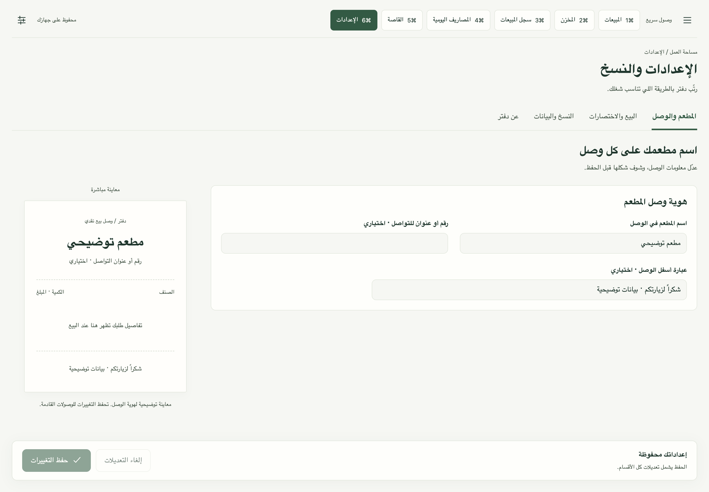
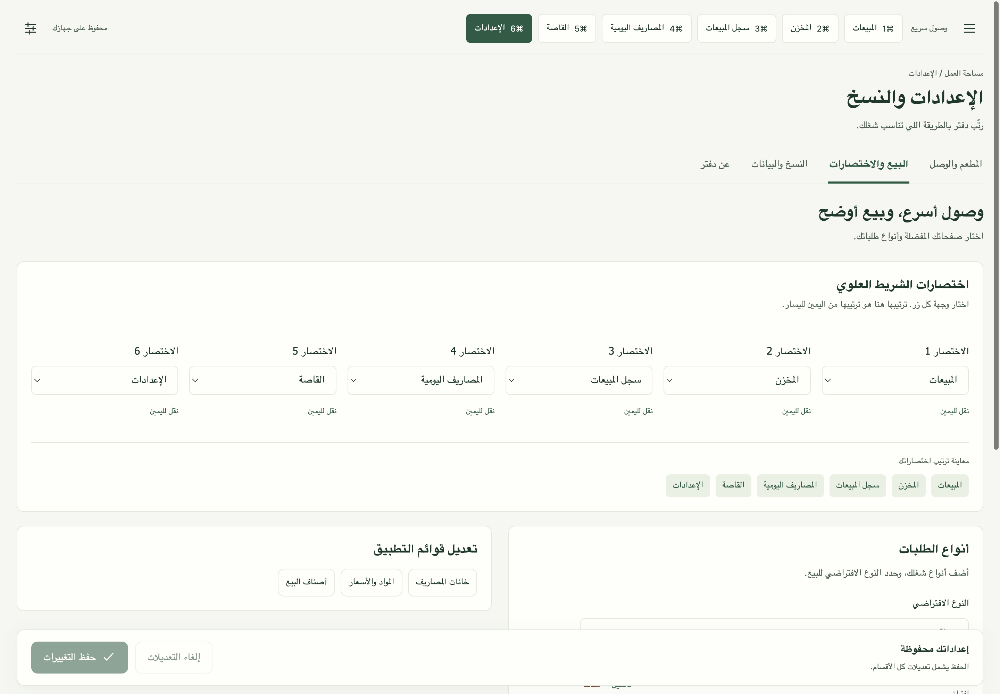

# Phase 09 — Settings, backups, import and recovery

Status: planned, not implemented. Date: 2026-10-27. Depends on: 01, 02, 04, 06, 08.

Outcome: A user can configure the app and safely move or restore all finalized records.

Includes former phase(s): 16. [Merge rationale and old-to-new map](../phase-map.md).

[Master plan](../README.md) · [Screenshot gallery](../gallery.html?phase=09) · [Design contract](../design-system.md) · [Accounting contract](../accounting-parity.md)

Execution rules: [AGENTS.md](../../../../AGENTS.md) · scope index: [PLANS.md](../../../../PLANS.md) · authoritative status/evidence: [PHASES.md](../../../../PHASES.md). This published scope file does not establish phase completion.

## Work to deliver

### Settings, backups, import and recovery

- [ ] Reproduce restaurant identity/live receipt preview, workflow, data/backup and about sections, a shared save/discard bar and dirty-state protection.
- [ ] Implement shortcut ordering and order-type add/rename/enable/disable/delete/default rules. At least one enabled type; unique names across both lists; maximum 20. Existing sales retain their original type.
- [ ] Export the complete validated account schema. Import is replacement, not merge: inspect counts/coverage/version, confirm replacement and create a pre-import backup before committing.
- [ ] Show backup status and previous-copy recovery, invalid/unreadable/oversized file states and explicit cancel paths. Mobile uses system file/share surfaces instead of a desktop folder path.
- [ ] Preserve retired worker data and account preferences. Keep active/held tickets and compact-display preference device-only. Explain that copying a backup is a manual handoff, not synchronization.

## Acceptance for this feature

- [ ] Export on macOS → import on Android → export → import on iPhone → reimport in a separate test account preserves finalized records, IDs, totals and supported legacy data.
- [ ] Rejected/canceled import and failed recovery preserve current data. Successful replacement clears stale workspace safely; no account or draft silently mixes with another.

- [ ] Run this phase’s behavior tests with isolated synthetic records; save command/result evidence.
- [ ] Capture the implemented Flutter screen and dialogs on macOS, Android and iPhone; compare the same state and logical size against the references below.
- [ ] Verify empty, populated, invalid, loading, failed-save and retry/cancel states where applicable; test restart persistence for every changed record.
- [ ] Review with the owner at this phase. Preserve the current design unless an explicit change is recorded; an undecided edit does not authorize a redesign.
- [ ] Update feature coverage, decisions and the project log; synchronize project documentation and verify no pending/failed memory work.
- [ ] Satisfy the adopted workflow: dedicated phase branch/worktree and PR, applicable Figma validation and user design approval (or Design: N/A), read-only planning, meaningful tests before behavior changes, independent review/re-verification and required CI/benchmark evidence.
- [ ] Record user approval, merged PR and applicable release/rollback validation in PHASES.md before marking DONE. Never merge without user approval or automatically start the next phase.

## Screenshot references

These are current Electron screenshots with synthetic data, except the explicitly labelled design board and report HTML. They specify composition and current behavior; they do not prove a Flutter implementation. Phone captures are narrow current-UI references, not native Android/iPhone captures. See the capture contract before comparing pixels.

| Reference | Kind |
| --- | --- |
| [desktop-settings](../screenshots/desktop-settings.png) | Full viewport |
| [desktop-settings-workflow](../screenshots/desktop-settings-workflow.png) | Full viewport |
| [desktop-settings-data](../screenshots/desktop-settings-data.png) | Full viewport |
| [desktop-settings-about](../screenshots/desktop-settings-about.png) | Full viewport |
| [phone-settings-data](../screenshots/phone-settings-data.png) | Narrow viewport |
| [desktop-settings-bottom](../screenshots/desktop-settings-bottom.png) | Full viewport |
| [desktop-settings-restaurant](../screenshots/desktop-settings-restaurant.png) | Full viewport |
| [desktop-settings-restaurant-bottom](../screenshots/desktop-settings-restaurant-bottom.png) | Full viewport |
| [desktop-settings-workflow-bottom](../screenshots/desktop-settings-workflow-bottom.png) | Full viewport |
| [desktop-settings-data-bottom](../screenshots/desktop-settings-data-bottom.png) | Full viewport |
| [desktop-settings-about-bottom](../screenshots/desktop-settings-about-bottom.png) | Full viewport |
| [empty-settings](../screenshots/empty-settings.png) | Full viewport |
| [phone-settings](../screenshots/phone-settings.png) | Narrow viewport |
| [phone-settings-bottom](../screenshots/phone-settings-bottom.png) | Narrow viewport |
| [phone-settings-restaurant](../screenshots/phone-settings-restaurant.png) | Narrow viewport |
| [phone-settings-restaurant-bottom](../screenshots/phone-settings-restaurant-bottom.png) | Narrow viewport |
| [phone-settings-workflow](../screenshots/phone-settings-workflow.png) | Narrow viewport |
| [phone-settings-workflow-bottom](../screenshots/phone-settings-workflow-bottom.png) | Narrow viewport |
| [phone-settings-data-bottom](../screenshots/phone-settings-data-bottom.png) | Narrow viewport |
| [phone-settings-about](../screenshots/phone-settings-about.png) | Narrow viewport |
| [phone-settings-about-bottom](../screenshots/phone-settings-about-bottom.png) | Narrow viewport |
| [full-phone-settings](../screenshots/full-phone-settings.png) | Full document |
| [full-settings](../screenshots/full-settings.png) | Full document |

## Handoff for implementation

Read AGENTS.md, PLANS.md, PHASES.md, the master plan, this phase, its screenshot set and source evidence. Implement phase 09 only when the owner has started it and its dependencies are complete. First report source/reference mismatches, establish dedicated Git isolation and apply the design/approval gate where relevant. The Lead coordinates a read-only Planner, appropriate UX/Workers and an independent Reviewer. Preserve the current design and scope. End with working results, actual tests/captures, review and PR evidence in PHASES.md. Do not mark DONE before approved merge and applicable release validation; do not automatically start the next phase.
