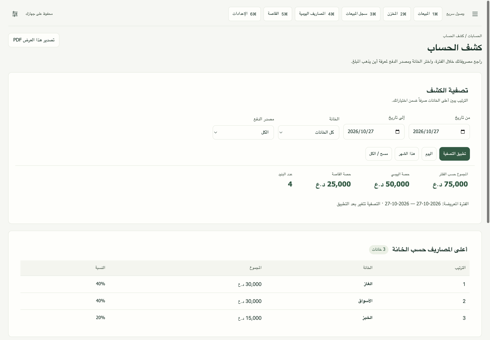
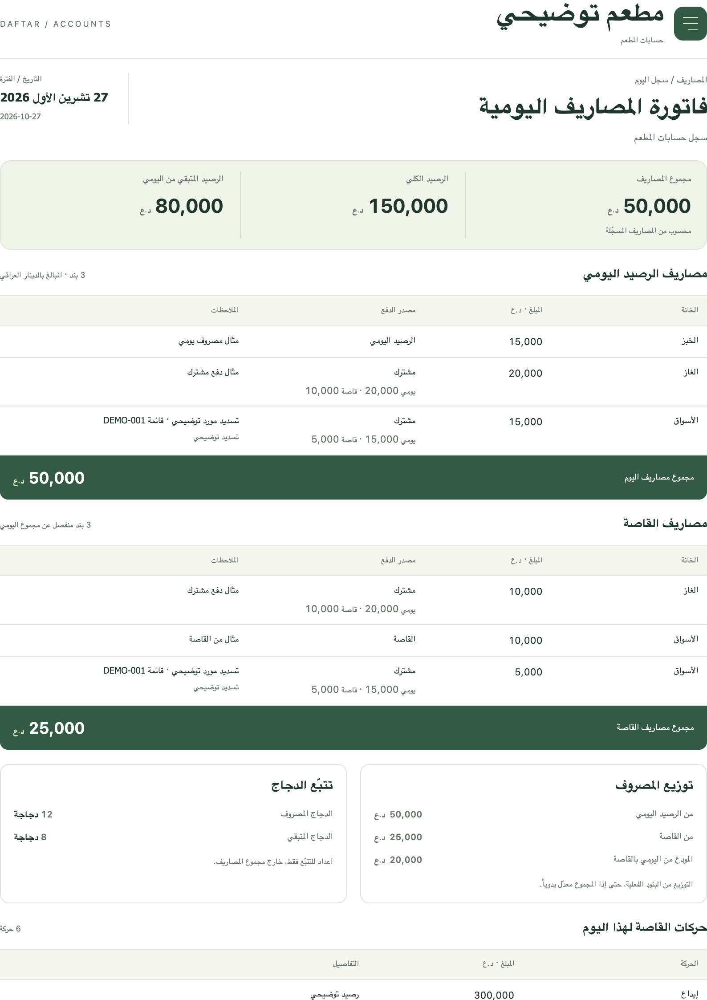

# Phase 10 — Statements, day review, PDF reports and printing

Status: planned, not implemented. Date: 2026-10-27. Depends on: 03, 04, 05, 06, 07, 08, 09.

Outcome: The owner can review paid spending and the restaurant day, then export/share/print every operational report.

Includes former phase(s): 10, 17. [Merge rationale and old-to-new map](../phase-map.md).

[Master plan](../README.md) · [Screenshot gallery](../gallery.html?phase=10) · [Design contract](../design-system.md) · [Accounting contract](../accounting-parity.md)

Execution rules: [AGENTS.md](../../../../AGENTS.md) · scope index: [PLANS.md](../../../../PLANS.md) · authoritative status/evidence: [PHASES.md](../../../../PHASES.md). This published scope file does not establish phase completion.

## Work to deliver

### Account statement and day review

- [ ] Reproduce from/to, category and source filters, date presets, summary amounts, descending category ranking, transaction detail and pagination.
- [ ] Use paid expenses and supplier payments, not unpaid invoice totals. Source-filtered shares remain correctly classified.
- [ ] Rebuild the short day-review dialog, temporary checkboxes, sales/refund/spending facts, record-remaining link, optional transfer and daily PDF link.
- [ ] Keep day review informational. It does not create an immutable closing record, lock a date or calculate profit.

### Arabic PDF reports, sharing and system printing

- [ ] Reproduce daily expenses, supplier invoice, sale receipt, period sales/refunds, account statement, cashbox and supplier-payment receipt. Retired worker reports remain compatibility code only, with no new visible workflow.
- [ ] Generate from validated saved records and stable IDs/filters, never user-provided HTML or editable display totals. Match Arabic shaping, RTL order, Latin numbers, A4 layout, table wrapping, page breaks, repeated headings and page numbering.
- [ ] Provide save/share/open actions on each target and normal system print dialogs. Cancel, denied file access, no printer and service failure leave the saved transaction intact.
- [ ] Use report HTML screenshots as content/style references, then render actual Flutter PDFs and inspect every page. HTML screenshots are not evidence of PDF output fidelity.
- [ ] No thermal printer/Bluetooth/ESC-POS work is included. Store signing, sharing and print integration evidence per platform.

## Acceptance for this feature

- [ ] Cash-source filtering shows zero daily share, matching the reference. Ranked totals reconcile to visible rows.
- [ ] Review checkboxes change no account data and no financial amount; links return to the correct daily context.
- [ ] Seven report kinds export from all three platforms; amounts and date/filter boundaries match on screen and in the file.
- [ ] Open/print/share is tested with native surfaces on physical devices; system print cancellation creates no new sale or payment. Arabic text is intact in short and multipage outputs.

- [ ] Run this phase’s behavior tests with isolated synthetic records; save command/result evidence.
- [ ] Capture the implemented Flutter screen and dialogs on macOS, Android and iPhone; compare the same state and logical size against the references below.
- [ ] Verify empty, populated, invalid, loading, failed-save and retry/cancel states where applicable; test restart persistence for every changed record.
- [ ] Review with the owner at this phase. Preserve the current design unless an explicit change is recorded; an undecided edit does not authorize a redesign.
- [ ] Update feature coverage, decisions and the project log; synchronize project documentation and verify no pending/failed memory work.
- [ ] Satisfy the adopted workflow: dedicated phase branch/worktree and PR, applicable Figma validation and user design approval (or Design: N/A), read-only planning, meaningful tests before behavior changes, independent review/re-verification and required CI/benchmark evidence.
- [ ] Record user approval, merged PR and applicable release/rollback validation in PHASES.md before marking DONE. Never merge without user approval or automatically start the next phase.

## Screenshot references

These are current Electron screenshots with synthetic data, except the explicitly labelled design board and report HTML. They specify composition and current behavior; they do not prove a Flutter implementation. Phone captures are narrow current-UI references, not native Android/iPhone captures. See the capture contract before comparing pixels.

| Reference | Kind |
| --- | --- |
| [desktop-statement](../screenshots/desktop-statement.png) | Full viewport |
| [full-statement](../screenshots/full-statement.png) | Full document |
| [desktop-day-review](../screenshots/desktop-day-review.png) | Full viewport |
| [phone-statement](../screenshots/phone-statement.png) | Narrow viewport |
| [report-daily](../screenshots/report-daily.png) | Full viewport |
| [report-invoice](../screenshots/report-invoice.png) | Full viewport |
| [report-sale](../screenshots/report-sale.png) | Full viewport |
| [report-sales](../screenshots/report-sales.png) | Full viewport |
| [report-statement](../screenshots/report-statement.png) | Full viewport |
| [report-cash](../screenshots/report-cash.png) | Full viewport |
| [report-payment](../screenshots/report-payment.png) | Full viewport |
| [desktop-statement-bottom](../screenshots/desktop-statement-bottom.png) | Full viewport |
| [empty-statement](../screenshots/empty-statement.png) | Full viewport |
| [phone-statement-bottom](../screenshots/phone-statement-bottom.png) | Narrow viewport |
| [full-phone-statement](../screenshots/full-phone-statement.png) | Full document |
| [report-daily-full](../screenshots/report-daily-full.png) | Full document |
| [report-invoice-full](../screenshots/report-invoice-full.png) | Full document |
| [report-sale-full](../screenshots/report-sale-full.png) | Full document |
| [report-sales-full](../screenshots/report-sales-full.png) | Full document |
| [report-statement-full](../screenshots/report-statement-full.png) | Full document |
| [report-cash-full](../screenshots/report-cash-full.png) | Full document |
| [report-payment-full](../screenshots/report-payment-full.png) | Full document |

## Handoff for implementation

Read AGENTS.md, PLANS.md, PHASES.md, the master plan, this phase, its screenshot set and source evidence. Implement phase 10 only when the owner has started it and its dependencies are complete. First report source/reference mismatches, establish dedicated Git isolation and apply the design/approval gate where relevant. The Lead coordinates a read-only Planner, appropriate UX/Workers and an independent Reviewer. Preserve the current design and scope. End with working results, actual tests/captures, review and PR evidence in PHASES.md. Do not mark DONE before approved merge and applicable release validation; do not automatically start the next phase.
