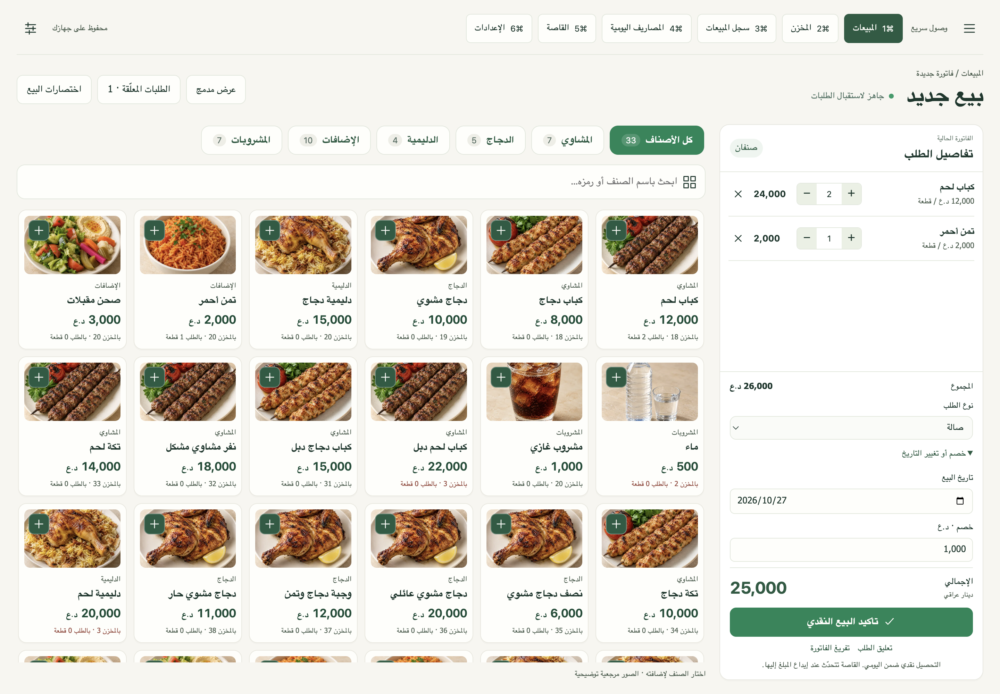

# Phase 11 — Complete MVP verification, migration rehearsal and release

Status: planned, not implemented. Date: 2026-10-27. Depends on: 00–10.

Outcome: Installable MVP builds on all three platforms, with end-to-end evidence and rollback instructions.

Includes former phase(s): 18. [Merge rationale and old-to-new map](../phase-map.md).

[Master plan](../README.md) · [Screenshot gallery](../gallery.html?phase=11) · [Design contract](../design-system.md) · [Accounting contract](../accounting-parity.md)

Execution rules: [AGENTS.md](../../../../AGENTS.md) · scope index: [PLANS.md](../../../../PLANS.md) · authoritative status/evidence: [PHASES.md](../../../../PHASES.md). This published scope file does not establish phase completion.

## Work to deliver

### Complete MVP verification, migration rehearsal and release

- [ ] Run the full synthetic restaurant-day scenario in release/profile builds: import, products/opening stock, invoice, partial shared payment, sales, hold/resume, return, expenses, remaining snapshot, transfer, day review, reports, export, restart and restore.
- [ ] Run the complete parity suite, widget tests and integration tests. Compare macOS/Android/iPhone captures to the frozen references and approved per-platform goldens. Record deliberate differences and owner decisions.
- [ ] Test app kill/resume, device offline/restart, duplicate tap, disk full, bad file, unknown schema, long Arabic names, large datasets, small screens, landscape, safe area, keyboard open, large text and accessibility semantics.
- [ ] Build signed installable artifacts for macOS/Android/iPhone through the chosen distribution route. Validate installation, launch, native import/export/share/print and update persistence on physical target devices.
- [ ] Rehearse migration using synthetic legacy copies first. Before any later live cutover, make a private verified backup and keep Electron available for rollback. Never point both implementations at the same writable accounts file.
- [ ] Deliver app builds, source, release notes, backup/import/restore manual, known issues and rollback procedure. Public store publishing is a separate explicit action if requested.

## Acceptance for this feature

- [ ] All checks in mvp-acceptance.md pass with attached evidence. No data-loss, duplicate-posting or incorrect-financial-total defect is open.
- [ ] Each target has a real install/run record, migration round-trip and native service results. Any missing signing/device/printer requirement is reported as a remaining blocker, not marked passed.

- [ ] Run this phase’s behavior tests with isolated synthetic records; save command/result evidence.
- [ ] Capture the implemented Flutter screen and dialogs on macOS, Android and iPhone; compare the same state and logical size against the references below.
- [ ] Verify empty, populated, invalid, loading, failed-save and retry/cancel states where applicable; test restart persistence for every changed record.
- [ ] Review with the owner at this phase. Preserve the current design unless an explicit change is recorded; an undecided edit does not authorize a redesign.
- [ ] Update feature coverage, decisions and the project log; synchronize project documentation and verify no pending/failed memory work.
- [ ] Satisfy the adopted workflow: dedicated phase branch/worktree and PR, applicable Figma validation and user design approval (or Design: N/A), read-only planning, meaningful tests before behavior changes, independent review/re-verification and required CI/benchmark evidence.
- [ ] Record user approval, merged PR and applicable release/rollback validation in PHASES.md before marking DONE. Never merge without user approval or automatically start the next phase.

## Screenshot references

These are current Electron screenshots with synthetic data, except the explicitly labelled design board and report HTML. They specify composition and current behavior; they do not prove a Flutter implementation. Phone captures are narrow current-UI references, not native Android/iPhone captures. See the capture contract before comparing pixels.

| Reference | Kind |
| --- | --- |
| [desktop-sales-cart](../screenshots/desktop-sales-cart.png) | Full viewport |
| [desktop-expenses](../screenshots/desktop-expenses.png) | Full viewport |
| [desktop-invoice-new](../screenshots/desktop-invoice-new.png) | Full viewport |
| [phone-sales](../screenshots/phone-sales.png) | Narrow viewport |
| [phone-expenses](../screenshots/phone-expenses.png) | Narrow viewport |
| [report-daily](../screenshots/report-daily.png) | Full viewport |

## Handoff for implementation

Read AGENTS.md, PLANS.md, PHASES.md, the master plan, this phase, its screenshot set and source evidence. Implement phase 11 only when the owner has started it and its dependencies are complete. First report source/reference mismatches, establish dedicated Git isolation and apply the design/approval gate where relevant. The Lead coordinates a read-only Planner, appropriate UX/Workers and an independent Reviewer. Preserve the current design and scope. End with working results, actual tests/captures, review and PR evidence in PHASES.md. Do not mark DONE before approved merge and applicable release validation; do not automatically start the next phase.
