Publication note, 2026-10-30: these are the preserved Step1.5 native Penpot exports and their capture-time review state. They are not runtime or fresh approval evidence. See the [Step5 delivery record](../../../docs/phases/02-step5-delivery.md) for current gates.

# Phase 02 — final native design approval gallery

Status: owner approval pending. Native Penpot PNGs, not app runtime captures. Six pairs;30earlier boards preserved. Static UI does not prove persistence/native accessibility. Live-reader testing owner-excluded, not passed.

[Canonical editable Penpot page](https://design.penpot.app/#/workspace?team-id=bfddaaba-4180-81d4-8008-db9f13093baa&file-id=122350ae-89ad-8027-8008-dba0bd5cf454&page-id=122350ae-89ad-8027-8008-dba0bd5cf455). Saved revision90; no implementation or backend/policy approval.

English documentation bands follow the logical app viewport. New native text/controls are editable; inherited reference lettering includes vector outlines. Superseded pilots excluded. Optional full-file .penpot archive failed; saved cloud boards, PNGs, source/correction artifacts and audit remain available.

## A-status

### Design

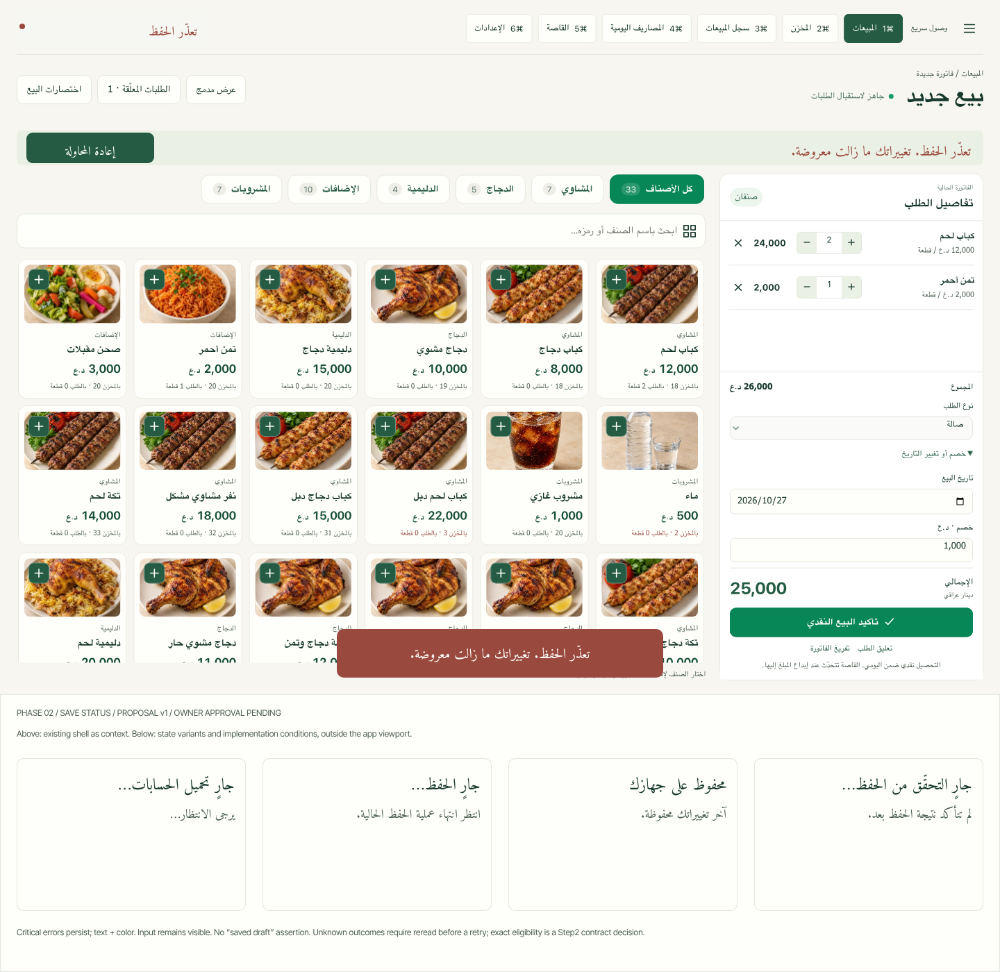

Board: `6038a601-8820-8088-8008-dd95cd39041c`. NativePNG SHA256: `f2e202a0be90532f38bc78bb2a7e07df5312f5cb80476cd3052b6ef5c444ffaa`.

### Wireframe

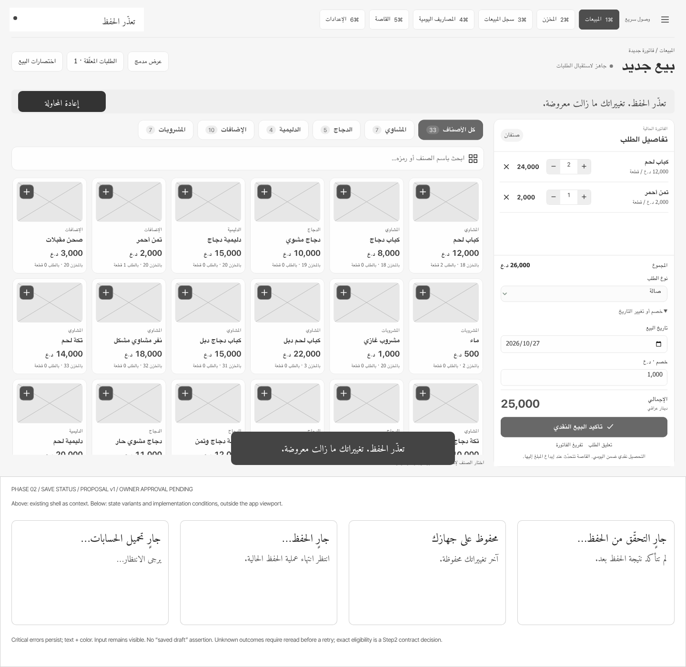

Board: `6038a601-8820-8088-8008-dd96fb7babe3`. NativePNG SHA256: `04b831bf909105262e39f5e83ced6d5ea64f2ae7708057c73b884b2387e98a58`.

## B-file-errors

### Design

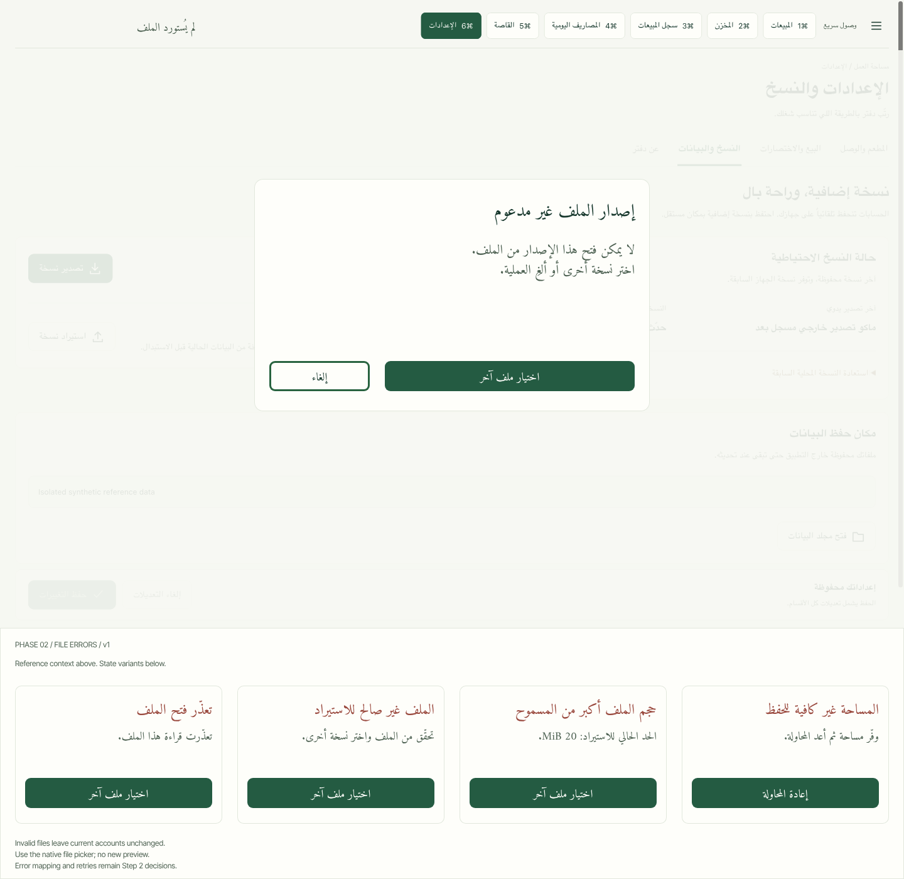

Board: `6038a601-8820-8088-8008-dd9713096e9f`. NativePNG SHA256: `2e495b5ae9b20e02c1272019ef70c603a7db9a42f457117531cae301189b39d9`.

### Wireframe

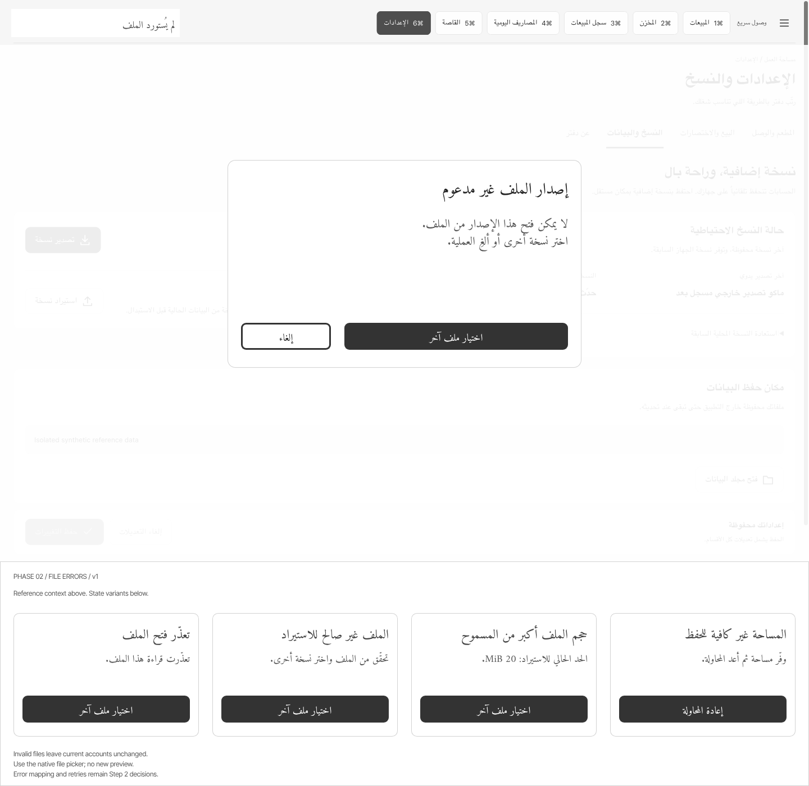

Board: `6038a601-8820-8088-8008-dd97493bbf5c`. NativePNG SHA256: `cac029ed72e42694cfb5e9d2a041f96bdb97689f854f5a755077e5ef3983138a`.

## C-recovery

### Design

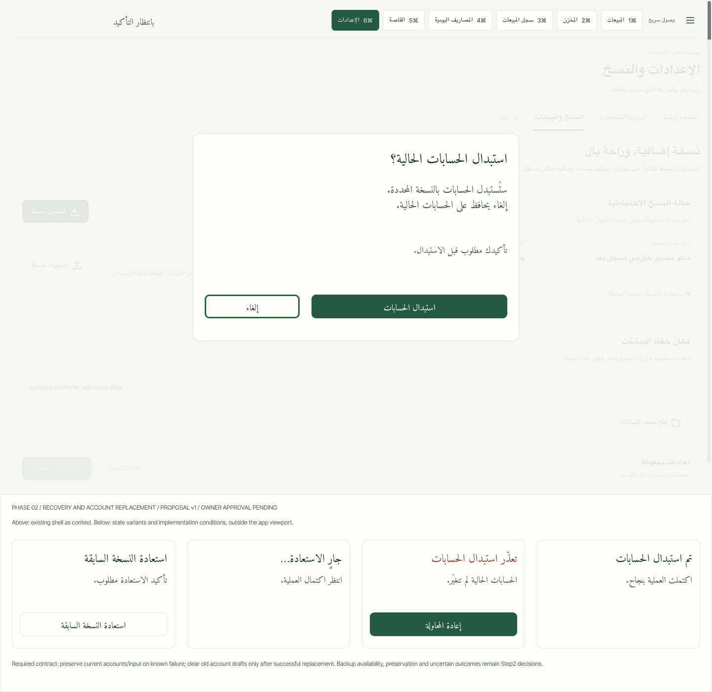

Board: `6038a601-8820-8088-8008-dd9762aa3b02`. NativePNG SHA256: `7e0cea45d82c9d10af69e99c8064cfe7a202af44442aae21aadd00860b637aa2`.

### Wireframe

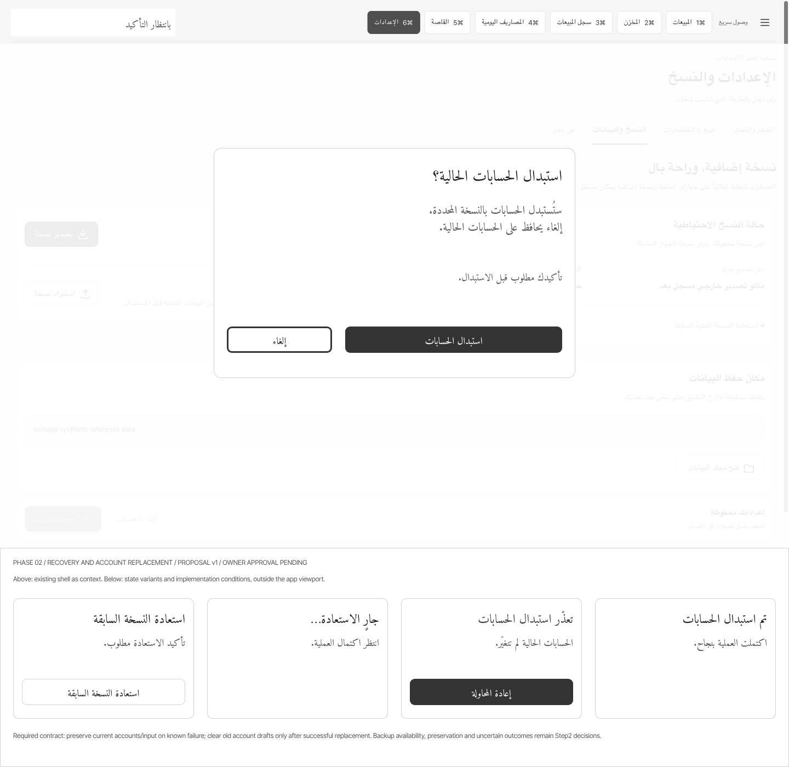

Board: `6038a601-8820-8088-8008-dd977b64868a`. NativePNG SHA256: `338ae55b89f25a8fbbbed95c74d234be4d85f03802db71e47fcc2ad0d0746c03`.

## D-narrow-status

### Design

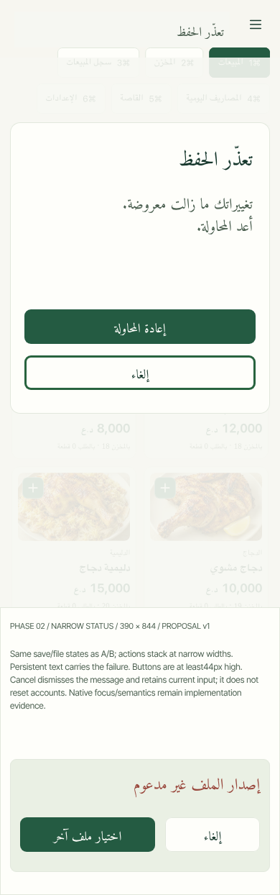

Board: `6038a601-8820-8088-8008-dd979596f451`. NativePNG SHA256: `a01351879a0e80dda81b8fef2c26b807ff5df6ebb9d9598bf5aa595a0fb28a5d`.

### Wireframe

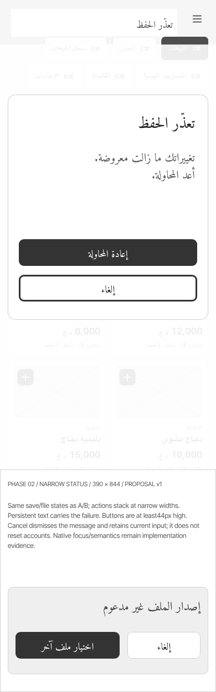

Board: `6038a601-8820-8088-8008-dd97a4b1654c`. NativePNG SHA256: `e56284947c897bb78510ac1b663d8f85c5e830753b16f34e4238375ca4203e26`.

## E-narrow-recovery

### Design

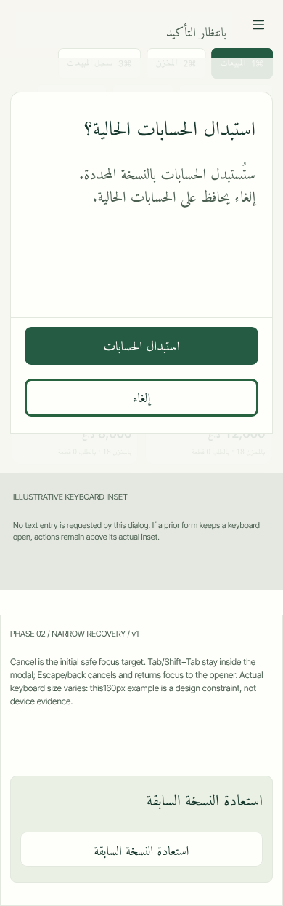

Board: `6038a601-8820-8088-8008-dd97b4c21f02`. NativePNG SHA256: `d7766046975a7025b2c8934edd2d56b074190007b6a094be1181180e95bb3da5`.

### Wireframe

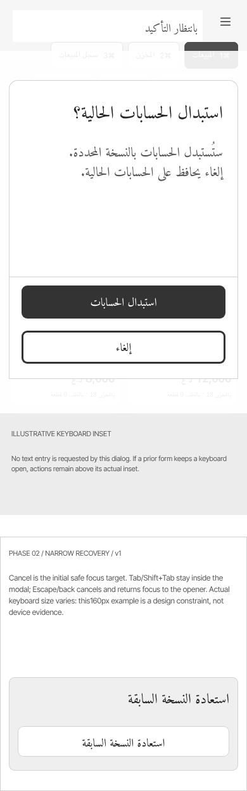

Board: `6038a601-8820-8088-8008-dd97c8ee7ea3`. NativePNG SHA256: `f82209c3e1f7043c34fca64531840cd5642b6e606f2c49904bb44d4b9ca15c40`.

## F-large-text

### Design

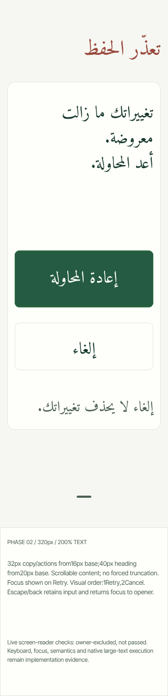

Board: `6038a601-8820-8088-8008-dd97dbb49c9e`. NativePNG SHA256: `989e1f65e63cb595d3dd0e5b19c9acdfbb39bc4013b055a93e7df36451ea1829`.

### Wireframe

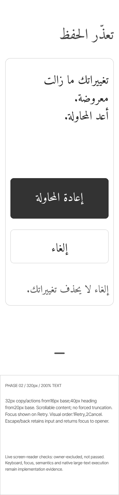

Board: `6038a601-8820-8088-8008-dd97e8631697`. NativePNG SHA256: `58e0f796e8dc949da589d6060a33202ebed98b78842107c13af3953a5fd65710`.
